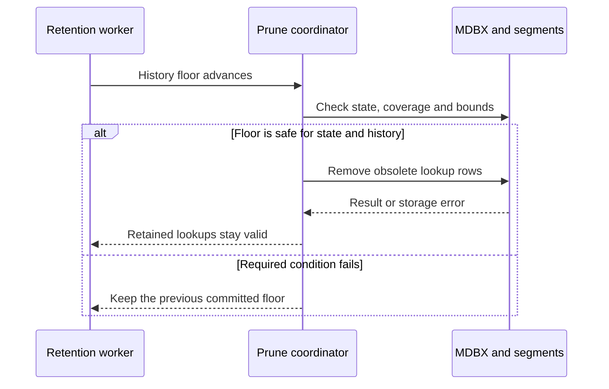
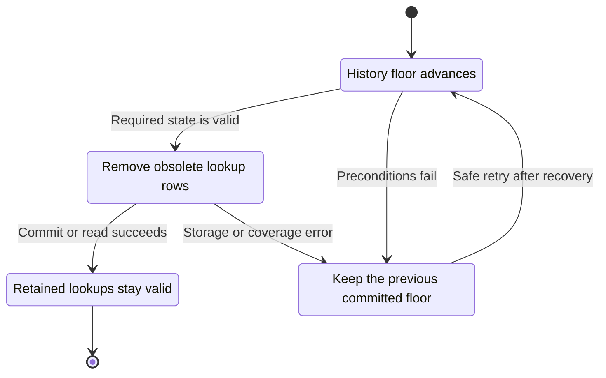
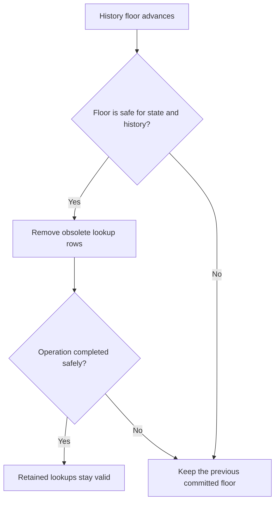

<!-- xone-gap-audit:2026-11-14:pass5:prune-txlookup -->
> GAP-0110 · P1 · audited source `54d8ae7da15c87dd77a7a86ca695c813bad5ec91`. Static code review; no production incident or measured speed/size gain is asserted.

## What

put_tx_lookup writes a hash-to-block-and-position row for every canonical transaction. prune_to removes canonical headers, segment indices, changesets and chunk files, but does not remove TxLookup rows. del_tx_lookup is used on unwind, not history pruning. A node that prunes history can therefore retain lookup rows for discarded history.

Current implementation:

- [`crates/xone-sync/src/mdbx/mod.rs`](https://github.com/XDCIndia/xOneRS/blob/54d8ae7da15c87dd77a7a86ca695c813bad5ec91/crates/xone-sync/src/mdbx/mod.rs)
- [`crates/xone-db/src/mdbx.rs`](https://github.com/XDCIndia/xOneRS/blob/54d8ae7da15c87dd77a7a86ca695c813bad5ec91/crates/xone-db/src/mdbx.rs)

## Why

The lookup table can grow with all executed transactions even when the history window is bounded. Retention must cover the index as well as its underlying records. Reth explicitly prunes TransactionHashNumbers; Geth maintains and removes transaction lookup history in its transaction indexer.

Verified competitor references:

- paradigmxyz/reth: [`crates/prune/prune/src/segments/user/transaction_lookup.rs`](https://github.com/paradigmxyz/reth/blob/36600d5ff9628465475dd4c7608e2e9f2fe24273/crates/prune/prune/src/segments/user/transaction_lookup.rs)
- ethereum/go-ethereum: [`core/txindexer.go`](https://github.com/ethereum/go-ethereum/blob/8059ff8beb3170eb8b977169ac51bb0423c97ee1/core/txindexer.go)

Related: #177 owns configurable history retention; #135 owns storage layout. This issue repairs the existing prune_to lifecycle, including obsolete lookup rows left by earlier runs. It does not add another retention-policy UI.

## 80% of the way to

1. Define a transaction-lookup retention floor consistent with body and receipt availability. Keep archive retention unchanged.
2. Delete lookup rows below that floor in bounded cursor pages before or with history publication. Check the stored block number before deleting a hash that may now name retained data.
3. Provide a bounded, resumable repair scan for existing rows whose bodies have already been removed. Do not require those missing bodies to discover stale rows.
4. Persist repair progress and retention changes safely with the MDBX transaction and manifest rules. Resume safely after interruption; retain the existing prune recovery ordering.
5. Extend pruning and recovery fixtures in crates/xone-sync/tests and document lookup behavior at the retention boundary.

Acceptance criteria:

- [ ] Repeated import/prune cycles leave no lookup row below the declared retained-history floor after cleanup completes.
- [ ] Retained transaction and receipt lookups return the same data before and after pruning; archive mode retains its lookups.
- [ ] A legacy datadir containing only stale lookup rows and no corresponding bodies is repaired with bounded temporary memory.
- [ ] Crash injection at cleanup, metadata commit and unlink boundaries recovers a consistent retention floor and can resume cleanup.
- [ ] Record table row counts, live pages and reusable pages separately; deletion alone must not be reported as filesystem shrinkage.

## ASD-STE100

1. Use the retained block number to select rows.
2. Keep rows that refer to retained blocks.
3. Delete obsolete rows before you discard their required data.
4. Save the repair position after each successful batch.
5. Test recovery at each commit boundary.

Technical terms follow repository usage. Sentence lengths follow the requested limits; approved-vocabulary certification has not been performed.

## Diagrams



## Images

N/A. This is a node/storage change. The linked code provides the comparison evidence.

## Prompt

```text
Implement GAP-0110 in XDCIndia/xOneRS: Prune transaction lookup rows with their retained history.
Audit pin: 54d8ae7da15c87dd77a7a86ca695c813bad5ec91. Re-pin current main and conformance/PIN before implementation.
Observed behavior: put_tx_lookup writes a hash-to-block-and-position row for every canonical transaction. prune_to removes canonical headers, segment indices, changesets and chunk files, but does not remove TxLookup rows. del_tx_lookup is used on unwind, not history pruning. A node that prunes history can therefore retain lookup rows for discarded history.
Read: crates/xone-sync/src/mdbx/mod.rs, crates/xone-db/src/mdbx.rs.
Implementation: Define a transaction-lookup retention floor consistent with body and receipt availability. Keep archive retention unchanged. Delete lookup rows below that floor in bounded cursor pages before or with history publication. Check the stored block number before deleting a hash that may now name retained data. Provide a bounded, resumable repair scan for existing rows whose bodies have already been removed. Do not require those missing bodies to discover stale rows. Persist repair progress and retention changes safely with the MDBX transaction and manifest rules. Resume safely after interruption; retain the existing prune recovery ordering. Extend pruning and recovery fixtures in crates/xone-sync/tests and document lookup behavior at the retention boundary.
Acceptance: Repeated import/prune cycles leave no lookup row below the declared retained-history floor after cleanup completes. Retained transaction and receipt lookups return the same data before and after pruning; archive mode retains its lookups. A legacy datadir containing only stale lookup rows and no corresponding bodies is repaired with bounded temporary memory. Crash injection at cleanup, metadata commit and unlink boundaries recovers a consistent retention floor and can resume cleanup. Record table row counts, live pages and reusable pages separately; deletion alone must not be reported as filesystem shrinkage.
Ownership: Related: #177 owns configurable history retention; #135 owns storage layout. This issue repairs the existing prune_to lifecycle, including obsolete lookup rows left by earlier runs. It does not add another retention-policy UI.
Use the immutable competitor links above as design evidence, with their license obligations. Preserve XDC consensus rules, wide balances, signatures, RPC compatibility, durable producer commits and ADR-005 publication ordering. Write focused failing tests through the real entry points; implement one coherent change. Run applicable format, lint, layering, fixture, conformance and targeted storage tests, and record exact commands/results. Any benchmark must pin hardware, dataset, build and durability under #13. Open a reviewable PR with measured limitations. Do not run experiments on validator hosts or claim completion from mocks alone.
```

## Workflow

1. **Retention worker:** History floor advances.
2. **Prune coordinator:** Validate the condition: floor is safe for state and history.
3. **Prune coordinator:** Remove obsolete lookup rows through mdbx and segments.
4. **Store owner:** Apply the existing atomic publication and error rules.
5. **Retention worker:** Receive the verified result or explicit failure defined above.

## Loop

Run with history pruning. Resume the legacy repair from its persisted cursor. Back off on storage errors; never advance coverage on a failed commit.

## Graph

Operation lifecycle; blockchain consensus state is unchanged.



## Layout

This change uses node configuration, diagnostics and existing APIs.

| Surface | Fields or placement |
| --- | --- |
| Configuration | Existing history retention settings; no second conflicting floor. |
| Progress | Retained floor, repair cursor, examined rows and deleted rows. |
| Errors | Storage failure and recovery state; do not report a completed repair before commit. |

## Flow



## Summary

Gap: Prune transaction lookup rows with their retained history.
Fix: Define a transaction-lookup retention floor consistent with body and receipt availability. Keep archive retention unchanged.
Acceptance: Repeated import/prune cycles leave no lookup row below the declared retained-history floor after cleanup completes.
