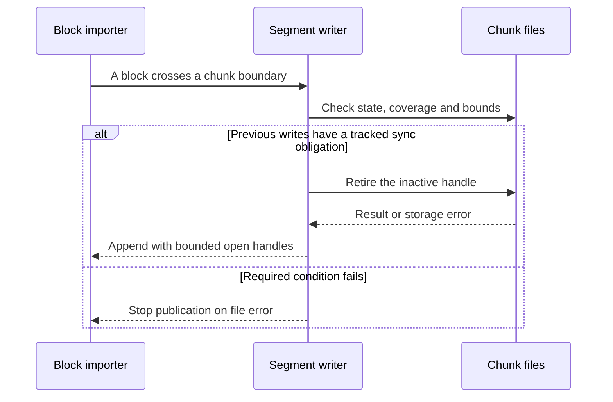
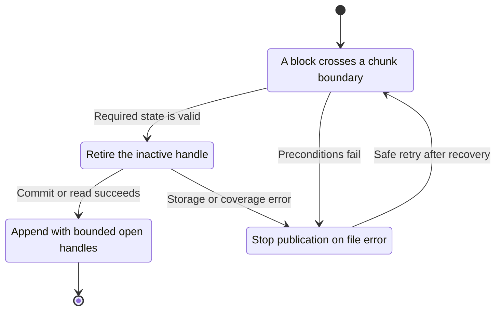
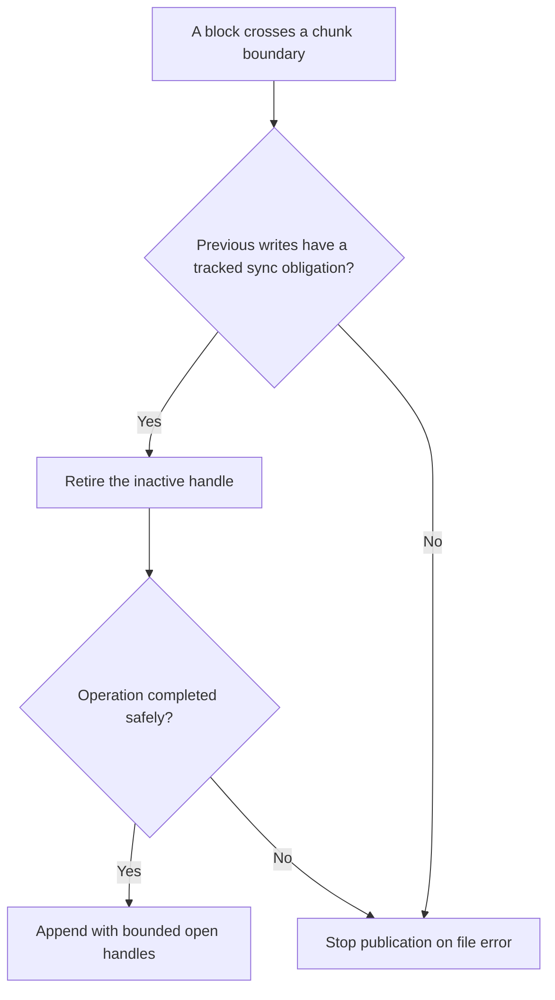

<!-- xone-gap-audit:2026-11-14:pass5:segment-writer-lifetime -->
> GAP-0111 · P1 · audited source `54d8ae7da15c87dd77a7a86ca695c813bad5ec91`. Static code review; no production incident or measured speed/size gain is asserted.

## What

Segs.writers is keyed by segment and chunk. stage inserts a file handle whenever a new chunk is opened. Normal chunk rotation does not remove the previous handle; only truncate and remove_chunk remove entries. An unpruned long-running store therefore retains writer handles for old chunks.

Current implementation:

- [`crates/xone-db/src/segments.rs`](https://github.com/XDCIndia/xOneRS/blob/54d8ae7da15c87dd77a7a86ca695c813bad5ec91/crates/xone-db/src/segments.rs)
- [`crates/xone-sync/src/mdbx/mod.rs`](https://github.com/XDCIndia/xOneRS/blob/54d8ae7da15c87dd77a7a86ca695c813bad5ec91/crates/xone-sync/src/mdbx/mod.rs)

## Why

Open writer handles should scale with active work, not total chain history. Otherwise long archive imports can exhaust process file descriptors. Reth keeps one cached writer per static-file segment and advances that writer when its range changes. This is evidence for writer lifetime management, not a claim that every Reth read handle is bounded by the same count.

Verified competitor references:

- paradigmxyz/reth: [`crates/storage/provider/src/providers/static_file/writer.rs`](https://github.com/paradigmxyz/reth/blob/36600d5ff9628465475dd4c7608e2e9f2fe24273/crates/storage/provider/src/providers/static_file/writer.rs)

Related: #16 defines resource bounds, #152 adds archive mode, and #194 adds frozen-segment compression. This is an independent handle-lifetime repair for the current uncompressed writer.

## 80% of the way to

1. Retire inactive writer handles on chunk transition, with a documented cap per segment. Do not retain a handle merely because its file remains readable.
2. Preserve deferred group-commit ordering. Track dirty chunk identities independently of cached handles and reopen a retired chunk when sync_deferred requires it.
3. Keep unwind, truncate, quarantine and remove_chunk behavior correct when a writer was already retired.
4. Add test instrumentation for peak open handles and a many-chunk fixture using small per_file values. Include durable and follower group-commit modes.
5. Run a subprocess fixture with a low descriptor limit and record its import/restart result. Keep foreground reads and write publication semantics unchanged.

Acceptance criteria:

- [ ] Thousands of chunk transitions keep writer-handle count within a documented constant bound independent of retained history.
- [ ] A deliberately low descriptor limit does not cause the many-chunk import to fail.
- [ ] A deferred batch spanning multiple chunks synchronizes every dirty file before MDBX becomes steady.
- [ ] Unwind, restart and prune at a chunk boundary retain identical canonical blocks and receipts.
- [ ] A failed reopen or sync follows the existing fail-stop path and does not silently publish durable status.

## ASD-STE100

1. Close each inactive writer when its chunk changes.
2. Keep the sync record until the file is durable.
3. Open the file again when a sync needs it.
4. Stop publication if the file operation fails.
5. Test rotation with a low file limit.

Technical terms follow repository usage. Sentence lengths follow the requested limits; approved-vocabulary certification has not been performed.

## Diagrams



## Images

N/A. This is a node/storage change. The linked code provides the comparison evidence.

## Prompt

```text
Implement GAP-0111 in XDCIndia/xOneRS: Bound segment writer handles across chunk rotation.
Audit pin: 54d8ae7da15c87dd77a7a86ca695c813bad5ec91. Re-pin current main and conformance/PIN before implementation.
Observed behavior: Segs.writers is keyed by segment and chunk. stage inserts a file handle whenever a new chunk is opened. Normal chunk rotation does not remove the previous handle; only truncate and remove_chunk remove entries. An unpruned long-running store therefore retains writer handles for old chunks.
Read: crates/xone-db/src/segments.rs, crates/xone-sync/src/mdbx/mod.rs.
Implementation: Retire inactive writer handles on chunk transition, with a documented cap per segment. Do not retain a handle merely because its file remains readable. Preserve deferred group-commit ordering. Track dirty chunk identities independently of cached handles and reopen a retired chunk when sync_deferred requires it. Keep unwind, truncate, quarantine and remove_chunk behavior correct when a writer was already retired. Add test instrumentation for peak open handles and a many-chunk fixture using small per_file values. Include durable and follower group-commit modes. Run a subprocess fixture with a low descriptor limit and record its import/restart result. Keep foreground reads and write publication semantics unchanged.
Acceptance: Thousands of chunk transitions keep writer-handle count within a documented constant bound independent of retained history. A deliberately low descriptor limit does not cause the many-chunk import to fail. A deferred batch spanning multiple chunks synchronizes every dirty file before MDBX becomes steady. Unwind, restart and prune at a chunk boundary retain identical canonical blocks and receipts. A failed reopen or sync follows the existing fail-stop path and does not silently publish durable status.
Ownership: Related: #16 defines resource bounds, #152 adds archive mode, and #194 adds frozen-segment compression. This is an independent handle-lifetime repair for the current uncompressed writer.
Use the immutable competitor links above as design evidence, with their license obligations. Preserve XDC consensus rules, wide balances, signatures, RPC compatibility, durable producer commits and ADR-005 publication ordering. Write focused failing tests through the real entry points; implement one coherent change. Run applicable format, lint, layering, fixture, conformance and targeted storage tests, and record exact commands/results. Any benchmark must pin hardware, dataset, build and durability under #13. Open a reviewable PR with measured limitations. Do not run experiments on validator hosts or claim completion from mocks alone.
```

## Workflow

1. **Block importer:** A block crosses a chunk boundary.
2. **Segment writer:** Validate the condition: previous writes have a tracked sync obligation.
3. **Segment writer:** Retire the inactive handle through chunk files.
4. **Store owner:** Apply the existing atomic publication and error rules.
5. **Block importer:** Receive the verified result or explicit failure defined above.

## Loop

Rotate on chunk boundaries. Deferred sync reopens dirty files as needed; handle eviction must not erase durability obligations.

## Graph

Operation lifecycle; blockchain consensus state is unchanged.



## Layout

This change uses node configuration, diagnostics and existing APIs.

| Surface | Fields or placement |
| --- | --- |
| Runtime | No new user-facing screen or flag is required. |
| Diagnostics | Active writer count and peak writer count in the storage test harness. |
| Failure | Existing typed file and synchronization errors. |

## Flow



## Summary

Gap: Bound segment writer handles across chunk rotation.
Fix: Retire inactive writer handles on chunk transition, with a documented cap per segment. Do not retain a handle merely because its file remains readable.
Acceptance: Thousands of chunk transitions keep writer-handle count within a documented constant bound independent of retained history.
