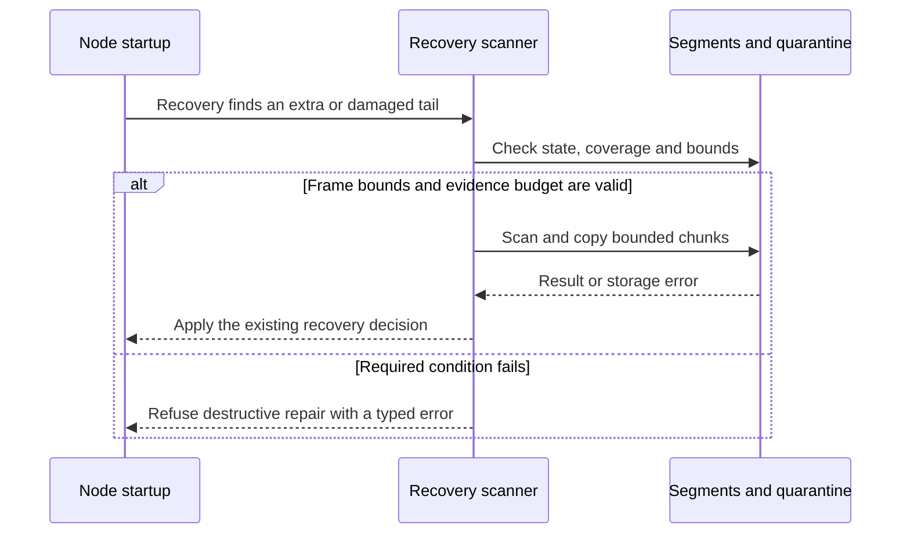
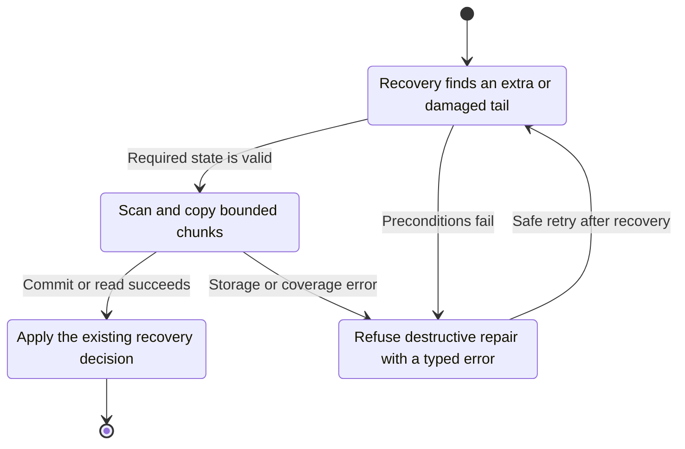
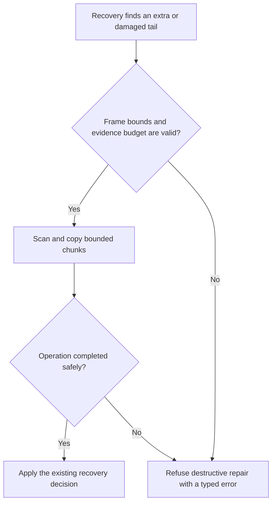

<!-- xone-gap-audit:2026-11-14:pass5:bounded-segment-recovery -->
> GAP-0112 · P1 · audited source `54d8ae7da15c87dd77a7a86ca695c813bad5ec91`. Static code review; no production incident or measured speed/size gain is asserted.

## What

Segs.scan allocates buffers from the complete committed-tail span and from file_len minus the committed length. quarantine allocates a buffer for the entire discarded suffix. A large or damaged tail can therefore make restart allocate memory proportional to file size before recovery decides what to retain.

Current implementation:

- [`crates/xone-db/src/segments.rs`](https://github.com/XDCIndia/xOneRS/blob/54d8ae7da15c87dd77a7a86ca695c813bad5ec91/crates/xone-db/src/segments.rs)
- [`crates/xone-db/src/recover.rs`](https://github.com/XDCIndia/xOneRS/blob/54d8ae7da15c87dd77a7a86ca695c813bad5ec91/crates/xone-db/src/recover.rs)
- [`crates/xone-sync/src/mdbx/mod.rs`](https://github.com/XDCIndia/xOneRS/blob/54d8ae7da15c87dd77a7a86ca695c813bad5ec91/crates/xone-sync/src/mdbx/mod.rs)

## Why

Recovery must remain usable on a large datadir and under memory pressure. Geth freezer repair reads fixed-size index entries while reconciling file boundaries instead of copying the whole data-file tail into memory. Its repair policy differs from ADR-005; only the bounded-access technique is the comparison here.

Verified competitor references:

- ethereum/go-ethereum: [`core/rawdb/freezer_table.go`](https://github.com/ethereum/go-ethereum/blob/8059ff8beb3170eb8b977169ac51bb0423c97ee1/core/rawdb/freezer_table.go)

Related: #11 owns crash-safe publication and the existing fault matrix. This issue replaces whole-tail allocations in the implemented recovery and quarantine paths without changing which manifest is authoritative.

## 80% of the way to

1. Read frame headers first, validate lengths and checked arithmetic, and scan complete frames with fixed-size buffers. Keep MAX_PAYLOAD enforcement before payload allocation.
2. Compute the committed-tail digest incrementally or validate a bounded frame representation that preserves the exact existing digest definition.
3. Copy quarantine suffixes with a fixed buffer and durable completion metadata. Preserve ADR-005 evidence before destructive repair; never silently truncate evidence because space is low.
4. Handle sparse files, truncated headers, invalid lengths, short reads and ENOSPC with typed recovery results. Leave the authoritative data untouched when quarantine cannot complete.
5. Use a synthetic SegFile with very large reported lengths to test requested allocation/read sizes without allocating a huge real file. Add crash tests around quarantine completion and truncation.

Acceptance criteria:

- [ ] Recovery and quarantine temporary buffers have a documented bound independent of the suffix length.
- [ ] A huge sparse or synthetic suffix cannot trigger an allocation proportional to file size.
- [ ] The streamed scan reports the same committed-tail digest validity and complete-frame count as the existing decoder on valid fixtures.
- [ ] Quarantine preserves the exact suffix bytes; interrupted or failed copies never authorize truncation of the only evidence.
- [ ] Malformed lengths, integer overflow, short reads and insufficient free space produce deterministic errors without a panic or OOM.

## ASD-STE100

1. Check each frame length before you allocate memory.
2. Read the file with a fixed buffer.
3. Keep the original data until the copy is complete.
4. Make the copy durable before you cut the source.
5. Report each failed read or write.

Technical terms follow repository usage. Sentence lengths follow the requested limits; approved-vocabulary certification has not been performed.

## Diagrams



## Images

N/A. This is a node/storage change. The linked code provides the comparison evidence.

## Prompt

```text
Implement GAP-0112 in XDCIndia/xOneRS: Stream segment recovery and quarantine with bounded buffers.
Audit pin: 54d8ae7da15c87dd77a7a86ca695c813bad5ec91. Re-pin current main and conformance/PIN before implementation.
Observed behavior: Segs.scan allocates buffers from the complete committed-tail span and from file_len minus the committed length. quarantine allocates a buffer for the entire discarded suffix. A large or damaged tail can therefore make restart allocate memory proportional to file size before recovery decides what to retain.
Read: crates/xone-db/src/segments.rs, crates/xone-db/src/recover.rs, crates/xone-sync/src/mdbx/mod.rs.
Implementation: Read frame headers first, validate lengths and checked arithmetic, and scan complete frames with fixed-size buffers. Keep MAX_PAYLOAD enforcement before payload allocation. Compute the committed-tail digest incrementally or validate a bounded frame representation that preserves the exact existing digest definition. Copy quarantine suffixes with a fixed buffer and durable completion metadata. Preserve ADR-005 evidence before destructive repair; never silently truncate evidence because space is low. Handle sparse files, truncated headers, invalid lengths, short reads and ENOSPC with typed recovery results. Leave the authoritative data untouched when quarantine cannot complete. Use a synthetic SegFile with very large reported lengths to test requested allocation/read sizes without allocating a huge real file. Add crash tests around quarantine completion and truncation.
Acceptance: Recovery and quarantine temporary buffers have a documented bound independent of the suffix length. A huge sparse or synthetic suffix cannot trigger an allocation proportional to file size. The streamed scan reports the same committed-tail digest validity and complete-frame count as the existing decoder on valid fixtures. Quarantine preserves the exact suffix bytes; interrupted or failed copies never authorize truncation of the only evidence. Malformed lengths, integer overflow, short reads and insufficient free space produce deterministic errors without a panic or OOM.
Ownership: Related: #11 owns crash-safe publication and the existing fault matrix. This issue replaces whole-tail allocations in the implemented recovery and quarantine paths without changing which manifest is authoritative.
Use the immutable competitor links above as design evidence, with their license obligations. Preserve XDC consensus rules, wide balances, signatures, RPC compatibility, durable producer commits and ADR-005 publication ordering. Write focused failing tests through the real entry points; implement one coherent change. Run applicable format, lint, layering, fixture, conformance and targeted storage tests, and record exact commands/results. Any benchmark must pin hardware, dataset, build and durability under #13. Open a reviewable PR with measured limitations. Do not run experiments on validator hosts or claim completion from mocks alone.
```

## Workflow

1. **Node startup:** Recovery finds an extra or damaged tail.
2. **Recovery scanner:** Validate the condition: frame bounds and evidence budget are valid.
3. **Recovery scanner:** Scan and copy bounded chunks through segments and quarantine.
4. **Store owner:** Apply the existing atomic publication and error rules.
5. **Node startup:** Receive the verified result or explicit failure defined above.

## Loop

Continue until the committed tail and suffix are checked. A restart retries incomplete quarantine safely; successful completion must be identifiable before truncation.

## Graph

Operation lifecycle; blockchain consensus state is unchanged.



## Layout

This change uses node configuration, diagnostics and existing APIs.

| Surface | Fields or placement |
| --- | --- |
| Recovery log | Segment, chunk, committed length, scanned bytes and decision. |
| Quarantine status | Source range, copied bytes and durable completion marker. |
| Failure | Malformed length, short read or insufficient space; retain original evidence. |

## Flow



## Summary

Gap: Stream segment recovery and quarantine with bounded buffers.
Fix: Read frame headers first, validate lengths and checked arithmetic, and scan complete frames with fixed-size buffers. Keep MAX_PAYLOAD enforcement before payload allocation.
Acceptance: Recovery and quarantine temporary buffers have a documented bound independent of the suffix length.
