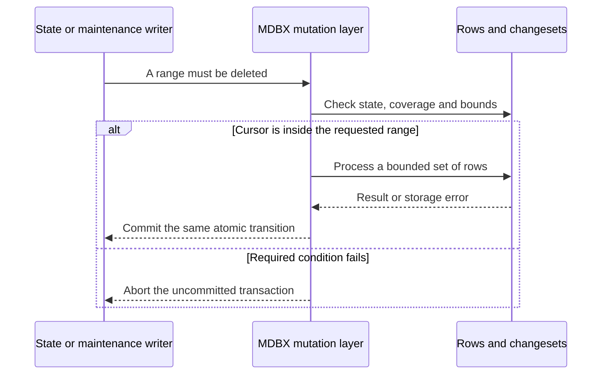
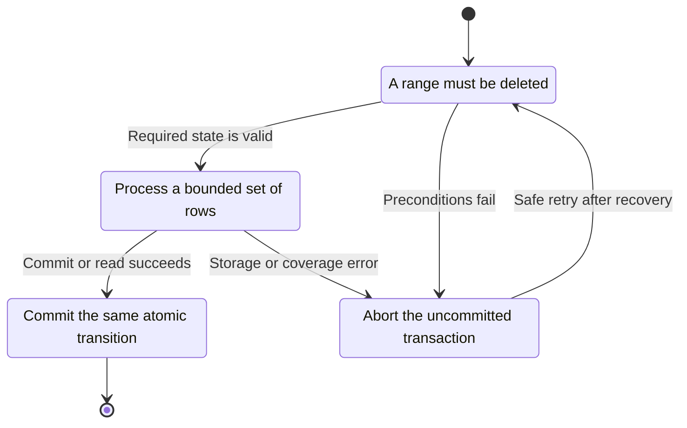
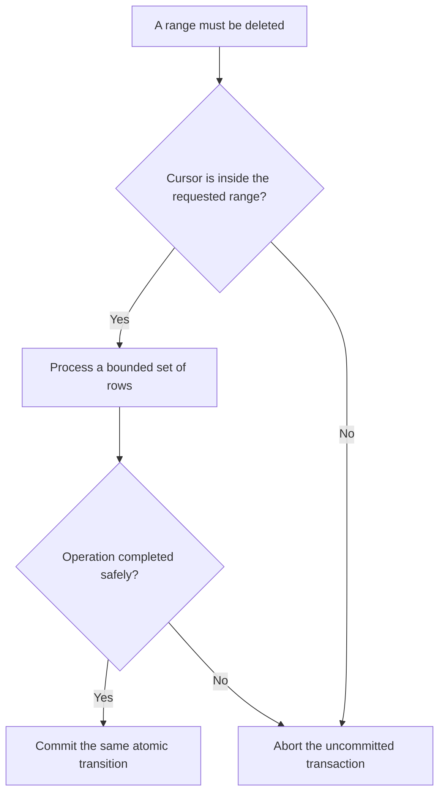

<!-- xone-gap-audit:2026-11-14:pass5:bounded-range-deletion -->
> GAP-0113 · P1 · audited source `54d8ae7da15c87dd77a7a86ca695c813bad5ec91`. Static code review; no production incident or measured speed/size gain is asserted.

## What

Tx::range delegates to range_limit with usize::MAX. del_range materializes that complete key/value vector before deleting rows. write_diff also obtains every storage slot for a removed account through prefix before recording changesets and deleting slots. These temporary vectors grow with the entire selected range, including on the disk-backed state path.

Current implementation:

- [`crates/xone-db/src/mdbx.rs`](https://github.com/XDCIndia/xOneRS/blob/54d8ae7da15c87dd77a7a86ca695c813bad5ec91/crates/xone-db/src/mdbx.rs)
- [`crates/xone-sync/src/mdbx/mod.rs`](https://github.com/XDCIndia/xOneRS/blob/54d8ae7da15c87dd77a7a86ca695c813bad5ec91/crates/xone-sync/src/mdbx/mod.rs)

## Why

Disk-backed state cannot provide bounded temporary memory if maintenance or account removal copies a huge range into RAM. Reth exposes mutable cursor deletion and bounded pruning iteration. The issue concerns application-side row buffering; MDBX dirty-page and transaction memory must be measured separately.

Verified competitor references:

- paradigmxyz/reth: [`crates/storage/db-api/src/cursor.rs`](https://github.com/paradigmxyz/reth/blob/36600d5ff9628465475dd4c7608e2e9f2fe24273/crates/storage/db-api/src/cursor.rs)
- paradigmxyz/reth: [`crates/prune/prune/src/segments/user/transaction_lookup.rs`](https://github.com/paradigmxyz/reth/blob/36600d5ff9628465475dd4c7608e2e9f2fe24273/crates/prune/prune/src/segments/user/transaction_lookup.rs)

Related: #145 owns disk-backed state and streamed snap installation; #177 owns history retention policy. This issue repairs remaining unbounded mutation helpers used by pruning, migration and account deletion. Preserve consensus transaction atomicity.

## 80% of the way to

1. Add a bounded mutation iterator or cursor-delete API in xone-db. Define safe cursor advancement after deleting the current key and at prefix boundaries.
2. Replace del_range and the removed-account storage loop with cursor or byte-bounded page processing. Use clear for a complete table only where semantics allow it.
3. Keep changeset generation and each block state transition in its original atomic write transaction. Do not split a consensus-visible transition into independently published batches.
4. For background pruning and schema migration, use bounded resumable transactions only when existing publication rules permit them.
5. Add fixtures for empty ranges, all-0xff prefixes, adjacent accounts, large values, millions of slots via generated data, unwind and interrupted migration. Report temporary-buffer and MDBX memory separately.

Acceptance criteria:

- [ ] Temporary row buffers remain within a documented byte bound as the deleted range grows.
- [ ] Every selected row is deleted exactly once and no adjacent-prefix row is deleted.
- [ ] Account removal records the prior storage values needed for an exact unwind.
- [ ] Crash injection preserves atomic block publication and the previous committed state.
- [ ] Retained state roots and receipts match the pinned XDC oracle fixtures; no new limit rejects an otherwise valid block.

## ASD-STE100

1. Copy only the rows needed for the current step.
2. Keep the cursor inside the selected range.
3. Save each prior value required for an unwind.
4. Commit the block as one atomic change.
5. Test the first and last keys of each range.

Technical terms follow repository usage. Sentence lengths follow the requested limits; approved-vocabulary certification has not been performed.

## Diagrams



## Images

N/A. This is a node/storage change. The linked code provides the comparison evidence.

## Prompt

```text
Implement GAP-0113 in XDCIndia/xOneRS: Bound temporary memory during range deletion and account storage removal.
Audit pin: 54d8ae7da15c87dd77a7a86ca695c813bad5ec91. Re-pin current main and conformance/PIN before implementation.
Observed behavior: Tx::range delegates to range_limit with usize::MAX. del_range materializes that complete key/value vector before deleting rows. write_diff also obtains every storage slot for a removed account through prefix before recording changesets and deleting slots. These temporary vectors grow with the entire selected range, including on the disk-backed state path.
Read: crates/xone-db/src/mdbx.rs, crates/xone-sync/src/mdbx/mod.rs.
Implementation: Add a bounded mutation iterator or cursor-delete API in xone-db. Define safe cursor advancement after deleting the current key and at prefix boundaries. Replace del_range and the removed-account storage loop with cursor or byte-bounded page processing. Use clear for a complete table only where semantics allow it. Keep changeset generation and each block state transition in its original atomic write transaction. Do not split a consensus-visible transition into independently published batches. For background pruning and schema migration, use bounded resumable transactions only when existing publication rules permit them. Add fixtures for empty ranges, all-0xff prefixes, adjacent accounts, large values, millions of slots via generated data, unwind and interrupted migration. Report temporary-buffer and MDBX memory separately.
Acceptance: Temporary row buffers remain within a documented byte bound as the deleted range grows. Every selected row is deleted exactly once and no adjacent-prefix row is deleted. Account removal records the prior storage values needed for an exact unwind. Crash injection preserves atomic block publication and the previous committed state. Retained state roots and receipts match the pinned XDC oracle fixtures; no new limit rejects an otherwise valid block.
Ownership: Related: #145 owns disk-backed state and streamed snap installation; #177 owns history retention policy. This issue repairs remaining unbounded mutation helpers used by pruning, migration and account deletion. Preserve consensus transaction atomicity.
Use the immutable competitor links above as design evidence, with their license obligations. Preserve XDC consensus rules, wide balances, signatures, RPC compatibility, durable producer commits and ADR-005 publication ordering. Write focused failing tests through the real entry points; implement one coherent change. Run applicable format, lint, layering, fixture, conformance and targeted storage tests, and record exact commands/results. Any benchmark must pin hardware, dataset, build and durability under #13. Open a reviewable PR with measured limitations. Do not run experiments on validator hosts or claim completion from mocks alone.
```

## Workflow

1. **State or maintenance writer:** A range must be deleted.
2. **MDBX mutation layer:** Validate the condition: cursor is inside the requested range.
3. **MDBX mutation layer:** Process a bounded set of rows through rows and changesets.
4. **Store owner:** Apply the existing atomic publication and error rules.
5. **State or maintenance writer:** Receive the verified result or explicit failure defined above.

## Loop

Advance the cursor until the range ends. Keep block transactions atomic; persist maintenance checkpoints only at valid transaction boundaries.

## Graph

Operation lifecycle; blockchain consensus state is unchanged.



## Layout

This change uses node configuration, diagnostics and existing APIs.

| Surface | Fields or placement |
| --- | --- |
| Internal API | Range start, exclusive end or prefix, and byte-bounded iteration. |
| Test output | Rows visited, peak copied bytes, dirty-page memory and final roots. |
| Failure | Typed database error; original committed state remains authoritative. |

## Flow



## Summary

Gap: Bound temporary memory during range deletion and account storage removal.
Fix: Add a bounded mutation iterator or cursor-delete API in xone-db. Define safe cursor advancement after deleting the current key and at prefix boundaries.
Acceptance: Temporary row buffers remain within a documented byte bound as the deleted range grows.
