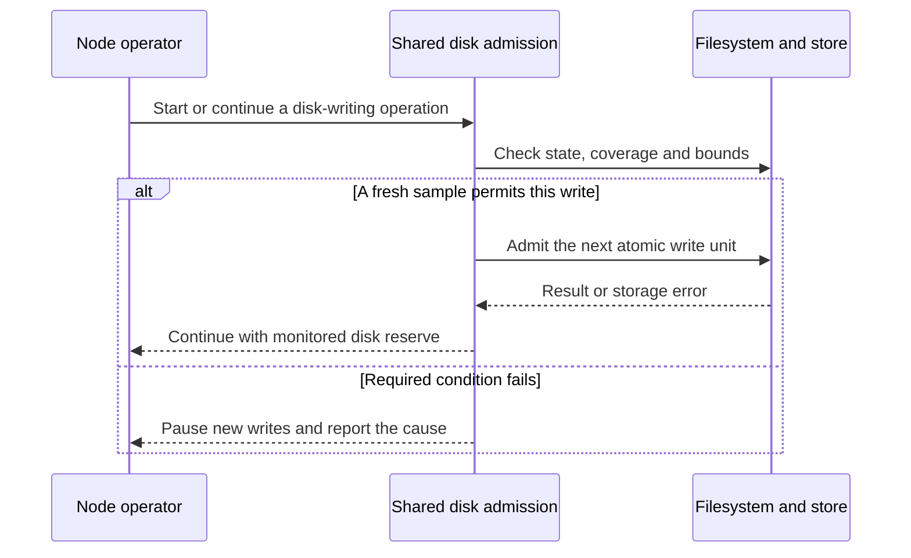
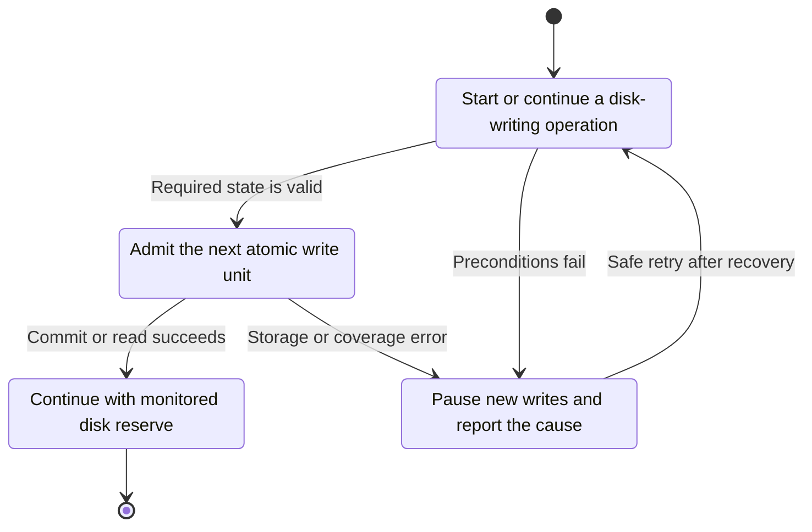
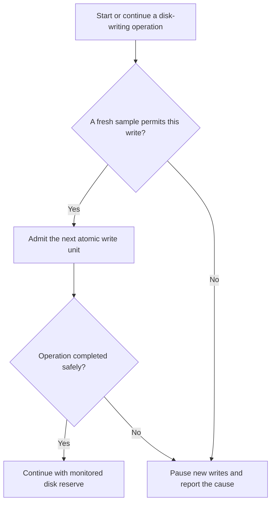

<!-- xone-gap-audit:2026-11-14:pass5:disk-admission-all-writers -->
> GAP-0114 · P1 · audited source `54d8ae7da15c87dd77a7a86ca695c813bad5ec91`. Static code review; no production incident or measured speed/size gain is asserted.

## What

The new DiskGuard passes an ImportGate to ChainService only. snap_sync runs before build creates the guard, and ProducerService receives no gate. DiskGuard.start reads total space but discards the first available-space result, then opens its sampling thread while the default gate is open. A failed sampler retains the previous gate state; df has no execution timeout.

Current implementation:

- [`crates/xone-node/src/diskguard.rs`](https://github.com/XDCIndia/xOneRS/blob/54d8ae7da15c87dd77a7a86ca695c813bad5ec91/crates/xone-node/src/diskguard.rs)
- [`crates/xone-node/src/services/mod.rs`](https://github.com/XDCIndia/xOneRS/blob/54d8ae7da15c87dd77a7a86ca695c813bad5ec91/crates/xone-node/src/services/mod.rs)
- [`crates/xone-node/src/services/snapsync.rs`](https://github.com/XDCIndia/xOneRS/blob/54d8ae7da15c87dd77a7a86ca695c813bad5ec91/crates/xone-node/src/services/snapsync.rs)
- [`crates/xone-node/src/services/producer.rs`](https://github.com/XDCIndia/xOneRS/blob/54d8ae7da15c87dd77a7a86ca695c813bad5ec91/crates/xone-node/src/services/producer.rs)
- [`crates/xone-node/src/services/core.rs`](https://github.com/XDCIndia/xOneRS/blob/54d8ae7da15c87dd77a7a86ca695c813bad5ec91/crates/xone-node/src/services/core.rs)

## Why

The low-space policy must cover writers that can fill the filesystem during bootstrap and block production, as well as follower import. Geth sends a process-wide shutdown signal when its disk monitor crosses the critical threshold. That source supports whole-node coverage; it does not prove that Geth implements all the startup and sampler-staleness requirements proposed here.

Verified competitor references:

- ethereum/go-ethereum: [`cmd/utils/cmd.go`](https://github.com/ethereum/go-ethereum/blob/8059ff8beb3170eb8b977169ac51bb0423c97ee1/cmd/utils/cmd.go)

Related: closed #16 introduced disk/resource bounds; PR #318 added the current guard. This issue closes uncovered entry points and sampling lifecycle gaps in that implementation. #225 separately owns moving history to another filesystem.

## 80% of the way to

1. Create one shared admission policy before SNAP bootstrap or persistent core initialization. Apply the first valid free-space sample synchronously before enabling writes.
2. Check admission at the common block/storage boundary and at bounded SNAP write batches. Cover follower import, local production and snapshot installation without stopping permitted reads.
3. Use a bounded filesystem-space probe or a subprocess with a timeout and bounded output. Define the maximum age of a usable sample; stop new discretionary writes when no valid sample remains.
4. Reserve enough space for required commit completion, signer safety state and clean shutdown. Never interrupt an atomic commit halfway or let a producer sign a block it cannot safely persist.
5. Test startup below the stop threshold, low disk during SNAP, local production while stopped, failed/hung probes, resume hysteresis and bounded shutdown. Extend existing Guard tests through actual service entry points.

Acceptance criteria:

- [ ] No SNAP batch or new block import starts before the initial admission decision.
- [ ] Low-space admission covers both locally produced blocks and peer-imported blocks.
- [ ] A hung or repeatedly failed probe cannot leave a stale open gate indefinitely or block shutdown indefinitely.
- [ ] An in-flight atomic commit completes or takes the existing fail-stop path; the guard does not bypass signer durability.
- [ ] Recovery above the resume line restores allowed work with one transition alarm; tests exercise the real node lifecycle.

## ASD-STE100

1. Read free space before you start new writes.
2. Use one admission state for all block writers.
3. Stop new writes when the sample is too old.
4. Finish each accepted atomic operation safely.
5. Keep the shutdown wait within its time limit.

Technical terms follow repository usage. Sentence lengths follow the requested limits; approved-vocabulary certification has not been performed.

## Diagrams



## Images

N/A. This is a node/storage change. The linked code provides the comparison evidence.

## Prompt

```text
Implement GAP-0114 in XDCIndia/xOneRS: Apply disk-space admission before bootstrap and all block writers.
Audit pin: 54d8ae7da15c87dd77a7a86ca695c813bad5ec91. Re-pin current main and conformance/PIN before implementation.
Observed behavior: The new DiskGuard passes an ImportGate to ChainService only. snap_sync runs before build creates the guard, and ProducerService receives no gate. DiskGuard.start reads total space but discards the first available-space result, then opens its sampling thread while the default gate is open. A failed sampler retains the previous gate state; df has no execution timeout.
Read: crates/xone-node/src/diskguard.rs, crates/xone-node/src/services/mod.rs, crates/xone-node/src/services/snapsync.rs, crates/xone-node/src/services/producer.rs, crates/xone-node/src/services/core.rs.
Implementation: Create one shared admission policy before SNAP bootstrap or persistent core initialization. Apply the first valid free-space sample synchronously before enabling writes. Check admission at the common block/storage boundary and at bounded SNAP write batches. Cover follower import, local production and snapshot installation without stopping permitted reads. Use a bounded filesystem-space probe or a subprocess with a timeout and bounded output. Define the maximum age of a usable sample; stop new discretionary writes when no valid sample remains. Reserve enough space for required commit completion, signer safety state and clean shutdown. Never interrupt an atomic commit halfway or let a producer sign a block it cannot safely persist. Test startup below the stop threshold, low disk during SNAP, local production while stopped, failed/hung probes, resume hysteresis and bounded shutdown. Extend existing Guard tests through actual service entry points.
Acceptance: No SNAP batch or new block import starts before the initial admission decision. Low-space admission covers both locally produced blocks and peer-imported blocks. A hung or repeatedly failed probe cannot leave a stale open gate indefinitely or block shutdown indefinitely. An in-flight atomic commit completes or takes the existing fail-stop path; the guard does not bypass signer durability. Recovery above the resume line restores allowed work with one transition alarm; tests exercise the real node lifecycle.
Ownership: Related: closed #16 introduced disk/resource bounds; PR #318 added the current guard. This issue closes uncovered entry points and sampling lifecycle gaps in that implementation. #225 separately owns moving history to another filesystem.
Use the immutable competitor links above as design evidence, with their license obligations. Preserve XDC consensus rules, wide balances, signatures, RPC compatibility, durable producer commits and ADR-005 publication ordering. Write focused failing tests through the real entry points; implement one coherent change. Run applicable format, lint, layering, fixture, conformance and targeted storage tests, and record exact commands/results. Any benchmark must pin hardware, dataset, build and durability under #13. Open a reviewable PR with measured limitations. Do not run experiments on validator hosts or claim completion from mocks alone.
```

## Workflow

1. **Node operator:** Start or continue a disk-writing operation.
2. **Shared disk admission:** Validate the condition: a fresh sample permits this write.
3. **Shared disk admission:** Admit the next atomic write unit through filesystem and store.
4. **Store owner:** Apply the existing atomic publication and error rules.
5. **Node operator:** Receive the verified result or explicit failure defined above.

## Loop

Sample on a bounded schedule. Re-evaluate at write-unit boundaries, retain hysteresis, and request clean exit at the existing critical threshold.

## Graph

Operation lifecycle; blockchain consensus state is unchanged.



## Layout

This change uses node configuration, diagnostics and existing APIs.

| Surface | Fields or placement |
| --- | --- |
| Configuration | Existing disk stop, resume, exit and sample settings; documented sample-age/probe timeout. |
| Status | Admission state, free bytes, sample age and last probe error. |
| Logs | One transition event with operation class: bootstrap, import or production. |

## Flow



## Summary

Gap: Apply disk-space admission before bootstrap and all block writers.
Fix: Create one shared admission policy before SNAP bootstrap or persistent core initialization. Apply the first valid free-space sample synchronously before enabling writes.
Acceptance: No SNAP batch or new block import starts before the initial admission decision.
