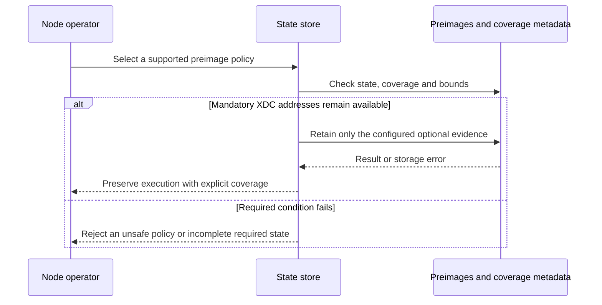
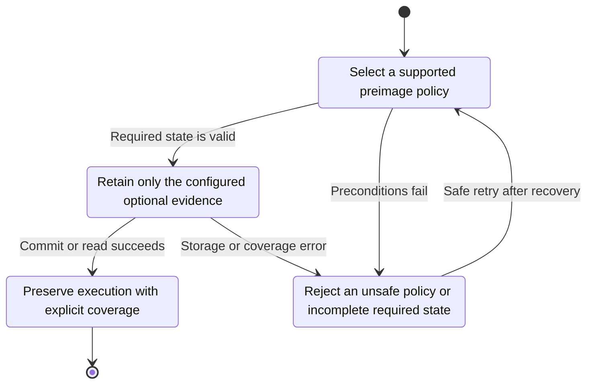
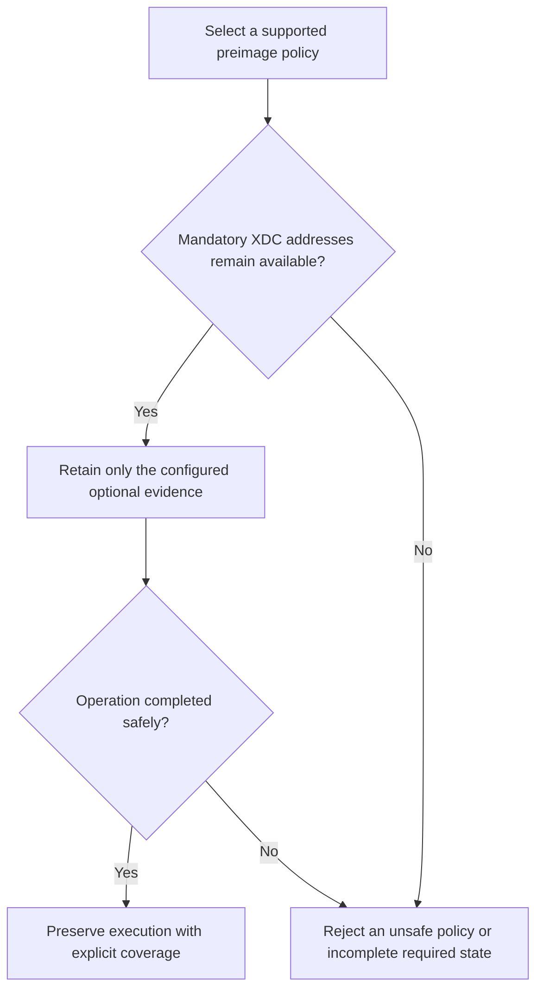

<!-- xone-gap-audit:2026-11-14:pass5:preimage-retention-policy -->
> GAP-0115 · P2 · audited source `54d8ae7da15c87dd77a7a86ca695c813bad5ec91`. Static code review; no production incident or measured speed/size gain is asserted.

## What

put_preimage unconditionally upserts address and slot preimages during execution; there is no preimage-retention option in node configuration. Most preimages serve export/debug/xpre capabilities, but XDC accounts above 2^256 require their address preimage when the executor rebuilds wide balances. A blanket preimage-off switch would therefore be incorrect.

Current implementation:

- [`crates/xone-sync/src/mdbx/mod.rs`](https://github.com/XDCIndia/xOneRS/blob/54d8ae7da15c87dd77a7a86ca695c813bad5ec91/crates/xone-sync/src/mdbx/mod.rs)
- [`crates/xone-node/src/services/core.rs`](https://github.com/XDCIndia/xOneRS/blob/54d8ae7da15c87dd77a7a86ca695c813bad5ec91/crates/xone-node/src/services/core.rs)
- [`crates/xone-node/src/services/snapsync.rs`](https://github.com/XDCIndia/xOneRS/blob/54d8ae7da15c87dd77a7a86ca695c813bad5ec91/crates/xone-node/src/services/snapsync.rs)
- [`crates/xone-node/src/config.rs`](https://github.com/XDCIndia/xOneRS/blob/54d8ae7da15c87dd77a7a86ca695c813bad5ec91/crates/xone-node/src/config.rs)
- [`bin/xone/src/flags.rs`](https://github.com/XDCIndia/xOneRS/blob/54d8ae7da15c87dd77a7a86ca695c813bad5ec91/bin/xone/src/flags.rs)

## Why

Operators should be able to reduce optional storage and write traffic with an explicit capability tradeoff. Geth exposes cache.preimages and buffers duplicate preimages. xOneRS must retain the additional XDC information that its execution and SNAP paths require. No disk-saving percentage is asserted before measurement.

Verified competitor references:

- ethereum/go-ethereum: [`cmd/utils/flags.go`](https://github.com/ethereum/go-ethereum/blob/8059ff8beb3170eb8b977169ac51bb0423c97ee1/cmd/utils/flags.go)
- ethereum/go-ethereum: [`triedb/preimages.go`](https://github.com/ethereum/go-ethereum/blob/8059ff8beb3170eb8b977169ac51bb0423c97ee1/triedb/preimages.go)

Related: closed #134 moved state to hashed keys and #149 measures datadir waste. This issue adds a supported retention policy and coverage contract, rather than changing the hashed-state architecture or deleting mandatory wide-account information.

## 80% of the way to

1. Define explicit keep-all and minimal-optional-preimage policies. Preserve the current default for compatibility; separate mandatory wide-account addresses from optional slot/address history.
2. Persist the policy and available coverage in metadata. Enforce it for execution, genesis, migration and snapshot installation, including accounts that become wide after an unwind or later execution.
3. Suppress repeated optional upserts with a bounded deduplication strategy. Measure any extra read cost before retaining a read-before-write path.
4. Make export/dump/xpre responses report missing coverage accurately. A later keep-all setting collects future evidence and must not claim historical preimages were reconstructed.
5. Add configuration/docs and fixtures for wide balances, restart, snap install, unwind, repeated writes and coverage-limited export. Keep destructive cleanup of old preimages out of this unit unless explicitly resumable and separately reviewed.

Acceptance criteria:

- [ ] Default policy preserves existing export and execution behavior.
- [ ] Minimal mode omits optional preimages but retains every address required for wide-balance reconstruction across restart, unwind and SNAP.
- [ ] State roots, receipts and block acceptance are identical in both modes.
- [ ] Missing preimage coverage is explicit; enabling keep-all later does not imply complete historical coverage.
- [ ] A repeated-write workload reports logical preimage bytes, table pages and write operations for both modes, without a fabricated savings target.

## ASD-STE100

1. Keep each address required for a wide balance.
2. Save the selected policy with the database metadata.
3. Do not report missing history as complete.
4. Keep each cache within its size limit.
5. Compare state roots in both modes.

Technical terms follow repository usage. Sentence lengths follow the requested limits; approved-vocabulary certification has not been performed.

## Diagrams



## Images

N/A. This is a node/storage change. The linked code provides the comparison evidence.

## Prompt

```text
Implement GAP-0115 in XDCIndia/xOneRS: Make optional preimage retention configurable while preserving wide balances.
Audit pin: 54d8ae7da15c87dd77a7a86ca695c813bad5ec91. Re-pin current main and conformance/PIN before implementation.
Observed behavior: put_preimage unconditionally upserts address and slot preimages during execution; there is no preimage-retention option in node configuration. Most preimages serve export/debug/xpre capabilities, but XDC accounts above 2^256 require their address preimage when the executor rebuilds wide balances. A blanket preimage-off switch would therefore be incorrect.
Read: crates/xone-sync/src/mdbx/mod.rs, crates/xone-node/src/services/core.rs, crates/xone-node/src/services/snapsync.rs, crates/xone-node/src/config.rs, bin/xone/src/flags.rs.
Implementation: Define explicit keep-all and minimal-optional-preimage policies. Preserve the current default for compatibility; separate mandatory wide-account addresses from optional slot/address history. Persist the policy and available coverage in metadata. Enforce it for execution, genesis, migration and snapshot installation, including accounts that become wide after an unwind or later execution. Suppress repeated optional upserts with a bounded deduplication strategy. Measure any extra read cost before retaining a read-before-write path. Make export/dump/xpre responses report missing coverage accurately. A later keep-all setting collects future evidence and must not claim historical preimages were reconstructed. Add configuration/docs and fixtures for wide balances, restart, snap install, unwind, repeated writes and coverage-limited export. Keep destructive cleanup of old preimages out of this unit unless explicitly resumable and separately reviewed.
Acceptance: Default policy preserves existing export and execution behavior. Minimal mode omits optional preimages but retains every address required for wide-balance reconstruction across restart, unwind and SNAP. State roots, receipts and block acceptance are identical in both modes. Missing preimage coverage is explicit; enabling keep-all later does not imply complete historical coverage. A repeated-write workload reports logical preimage bytes, table pages and write operations for both modes, without a fabricated savings target.
Ownership: Related: closed #134 moved state to hashed keys and #149 measures datadir waste. This issue adds a supported retention policy and coverage contract, rather than changing the hashed-state architecture or deleting mandatory wide-account information.
Use the immutable competitor links above as design evidence, with their license obligations. Preserve XDC consensus rules, wide balances, signatures, RPC compatibility, durable producer commits and ADR-005 publication ordering. Write focused failing tests through the real entry points; implement one coherent change. Run applicable format, lint, layering, fixture, conformance and targeted storage tests, and record exact commands/results. Any benchmark must pin hardware, dataset, build and durability under #13. Open a reviewable PR with measured limitations. Do not run experiments on validator hosts or claim completion from mocks alone.
```

## Workflow

1. **Node operator:** Select a supported preimage policy.
2. **State store:** Validate the condition: mandatory xdc addresses remain available.
3. **State store:** Retain only the configured optional evidence through preimages and coverage metadata.
4. **Store owner:** Apply the existing atomic publication and error rules.
5. **Node operator:** Receive the verified result or explicit failure defined above.

## Loop

Apply the policy to each state write and snapshot batch. Keep mandatory addresses through history transitions; never infer old coverage from a new flag.

## Graph

Operation lifecycle; blockchain consensus state is unchanged.



## Layout

This change uses node configuration, diagnostics and existing APIs.

| Surface | Fields or placement |
| --- | --- |
| Configuration | One documented retention option with the existing behavior as default. |
| Inspect output | Policy, coverage start and mandatory-address availability. |
| Export errors | Explicit unavailable-preimage result with the affected capability. |

## Flow



## Summary

Gap: Make optional preimage retention configurable while preserving wide balances.
Fix: Define explicit keep-all and minimal-optional-preimage policies. Preserve the current default for compatibility; separate mandatory wide-account addresses from optional slot/address history.
Acceptance: Default policy preserves existing export and execution behavior.
