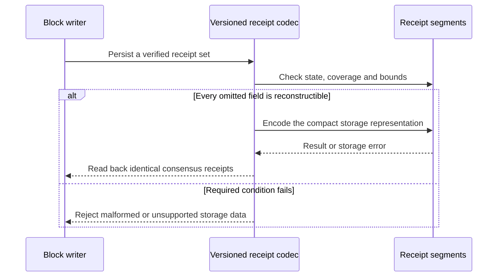
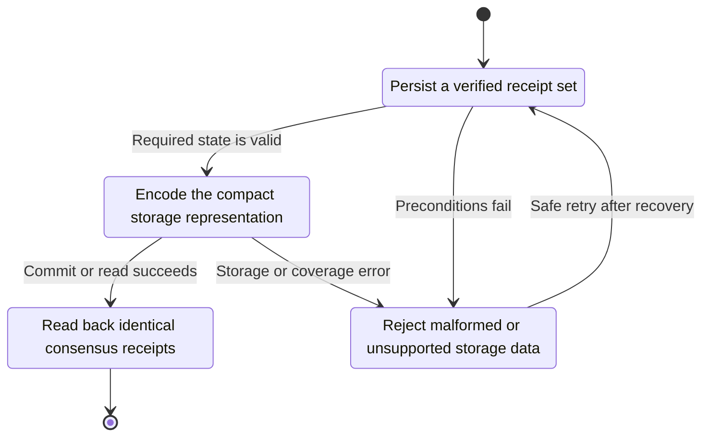
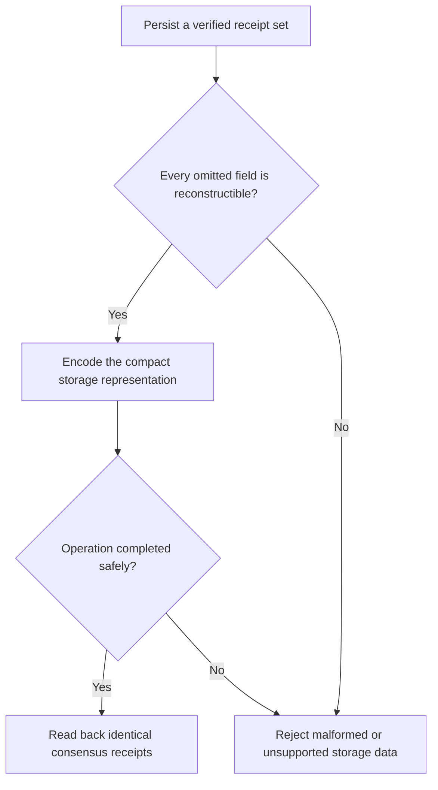

<!-- xone-gap-audit:2026-11-14:pass5:compact-receipt-codec -->
> GAP-0116 · P2 · audited source `54d8ae7da15c87dd77a7a86ca695c813bad5ec91`. Static code review; no production incident or measured speed/size gain is asserted.

## What

receipts_rlp persists the complete consensus receipt bytes in each receipt segment frame. Those bytes contain a bloom that can be derived from the receipt logs. The store currently has no compact logical receipt representation distinct from the consensus wire encoding.

Current implementation:

- [`crates/xone-sync/src/mdbx/codec.rs`](https://github.com/XDCIndia/xOneRS/blob/54d8ae7da15c87dd77a7a86ca695c813bad5ec91/crates/xone-sync/src/mdbx/codec.rs)
- [`crates/xone-db/src/segments.rs`](https://github.com/XDCIndia/xOneRS/blob/54d8ae7da15c87dd77a7a86ca695c813bad5ec91/crates/xone-db/src/segments.rs)
- [`crates/xone-executor/src/lib.rs`](https://github.com/XDCIndia/xOneRS/blob/54d8ae7da15c87dd77a7a86ca695c813bad5ec91/crates/xone-executor/src/lib.rs)
- [`crates/xone-rpc/src/json.rs`](https://github.com/XDCIndia/xOneRS/blob/54d8ae7da15c87dd77a7a86ca695c813bad5ec91/crates/xone-rpc/src/json.rs)

## Why

Geth ReceiptForStorage omits the bloom and reconstructs it in DeriveFields. A compact receipt codec can reduce logical bytes written in active and frozen segments. The net disk and latency effects require measurement, especially when whole-frame compression is also enabled.

Verified competitor references:

- ethereum/go-ethereum: [`core/types/receipt.go`](https://github.com/ethereum/go-ethereum/blob/8059ff8beb3170eb8b977169ac51bb0423c97ee1/core/types/receipt.go)

Related: #194 adds compression of frozen segment frames. This issue changes the logical receipt representation and can operate on active uncompressed segments. #276 addresses RPC serialization complexity, not persistent receipt size.

## 80% of the way to

1. Introduce an explicitly versioned storage-only receipt codec that preserves status or post-state, cumulative gas, transaction type and ordered logs. Omit only information proven reconstructible from retained data.
2. Reconstruct the exact existing consensus receipt bytes at store-reader boundaries. Keep peer responses, receipt roots, RPC bloom fields and XDC-specific receipt semantics unchanged.
3. Add format negotiation and mixed-version reads or a restart-safe migration. Old binaries must refuse an unsupported format instead of decoding it as the old RLP list.
4. Coordinate the version envelope with #194 so compression and compact encoding remain independently identifiable. Preserve manifest digests, CRCs, publication and crash recovery.
5. Measure raw logical bytes, allocated segment bytes, decode CPU and receipt-read latency for legacy, compact, compressed and combined variants on the same pinned workload.

Acceptance criteria:

- [ ] Round trips reconstruct byte-identical consensus receipts and identical receipt roots for every supported XDC receipt type.
- [ ] RPC and peer output remains identical, including blooms, log ordering and legacy status/post-state behavior.
- [ ] Restart, migration interruption, truncated frames and unsupported versions are handled by the storage recovery contract.
- [ ] Compact decoding does not depend on pruned transaction bodies to recover required type information.
- [ ] Publish measured byte savings and latency/CPU cost; retain the existing representation if acceptance budgets are not met.

## ASD-STE100

1. Keep the receipt type in the stored record.
2. Remove only data that you can reconstruct exactly.
3. Check the format version before you decode a record.
4. Keep the order of all logs.
5. Compare the reconstructed receipt bytes with the original bytes.

Technical terms follow repository usage. Sentence lengths follow the requested limits; approved-vocabulary certification has not been performed.

## Diagrams



## Images

N/A. This is a node/storage change. The linked code provides the comparison evidence.

## Prompt

```text
Implement GAP-0116 in XDCIndia/xOneRS: Store compact receipts without redundant per-receipt blooms.
Audit pin: 54d8ae7da15c87dd77a7a86ca695c813bad5ec91. Re-pin current main and conformance/PIN before implementation.
Observed behavior: receipts_rlp persists the complete consensus receipt bytes in each receipt segment frame. Those bytes contain a bloom that can be derived from the receipt logs. The store currently has no compact logical receipt representation distinct from the consensus wire encoding.
Read: crates/xone-sync/src/mdbx/codec.rs, crates/xone-db/src/segments.rs, crates/xone-executor/src/lib.rs, crates/xone-rpc/src/json.rs.
Implementation: Introduce an explicitly versioned storage-only receipt codec that preserves status or post-state, cumulative gas, transaction type and ordered logs. Omit only information proven reconstructible from retained data. Reconstruct the exact existing consensus receipt bytes at store-reader boundaries. Keep peer responses, receipt roots, RPC bloom fields and XDC-specific receipt semantics unchanged. Add format negotiation and mixed-version reads or a restart-safe migration. Old binaries must refuse an unsupported format instead of decoding it as the old RLP list. Coordinate the version envelope with #194 so compression and compact encoding remain independently identifiable. Preserve manifest digests, CRCs, publication and crash recovery. Measure raw logical bytes, allocated segment bytes, decode CPU and receipt-read latency for legacy, compact, compressed and combined variants on the same pinned workload.
Acceptance: Round trips reconstruct byte-identical consensus receipts and identical receipt roots for every supported XDC receipt type. RPC and peer output remains identical, including blooms, log ordering and legacy status/post-state behavior. Restart, migration interruption, truncated frames and unsupported versions are handled by the storage recovery contract. Compact decoding does not depend on pruned transaction bodies to recover required type information. Publish measured byte savings and latency/CPU cost; retain the existing representation if acceptance budgets are not met.
Ownership: Related: #194 adds compression of frozen segment frames. This issue changes the logical receipt representation and can operate on active uncompressed segments. #276 addresses RPC serialization complexity, not persistent receipt size.
Use the immutable competitor links above as design evidence, with their license obligations. Preserve XDC consensus rules, wide balances, signatures, RPC compatibility, durable producer commits and ADR-005 publication ordering. Write focused failing tests through the real entry points; implement one coherent change. Run applicable format, lint, layering, fixture, conformance and targeted storage tests, and record exact commands/results. Any benchmark must pin hardware, dataset, build and durability under #13. Open a reviewable PR with measured limitations. Do not run experiments on validator hosts or claim completion from mocks alone.
```

## Workflow

1. **Block writer:** Persist a verified receipt set.
2. **Versioned receipt codec:** Validate the condition: every omitted field is reconstructible.
3. **Versioned receipt codec:** Encode the compact storage representation through receipt segments.
4. **Store owner:** Apply the existing atomic publication and error rules.
5. **Block writer:** Receive the verified result or explicit failure defined above.

## Loop

Encode per committed block. Migrations process bounded chunks with restart checkpoints; no background format rewrite without an explicit migration state.

## Graph

Operation lifecycle; blockchain consensus state is unchanged.



## Layout

This change uses node configuration, diagnostics and existing APIs.

| Surface | Fields or placement |
| --- | --- |
| Storage metadata | Receipt codec version separate from compression version. |
| Inspect output | Logical receipt bytes, encoded segment bytes and codec coverage. |
| Compatibility | Existing RPC schemas and wire payloads remain unchanged. |

## Flow



## Summary

Gap: Store compact receipts without redundant per-receipt blooms.
Fix: Introduce an explicitly versioned storage-only receipt codec that preserves status or post-state, cumulative gas, transaction type and ordered logs. Omit only information proven reconstructible from retained data.
Acceptance: Round trips reconstruct byte-identical consensus receipts and identical receipt roots for every supported XDC receipt type.
