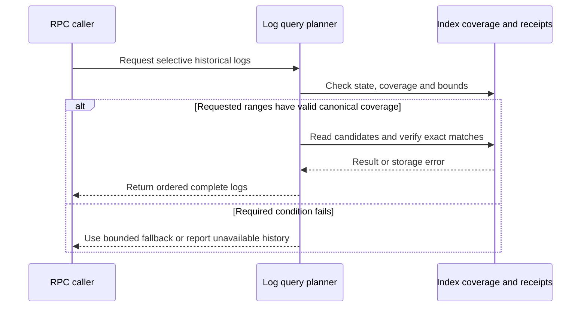
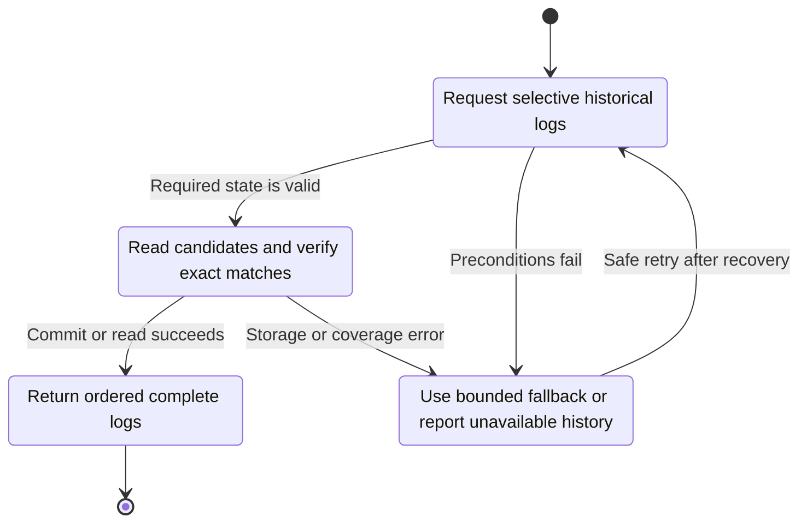
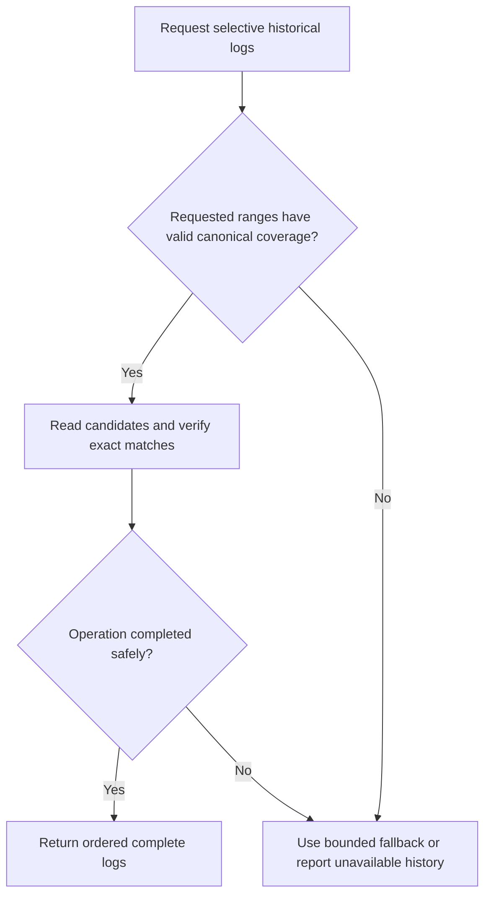

<!-- xone-gap-audit:2026-11-14:pass5:persistent-log-index -->
> GAP-0117 · P2 · audited source `54d8ae7da15c87dd77a7a86ca695c813bad5ec91`. Static code review; no production incident or measured speed/size gain is asserted.

## What

eth_getLogs enumerates every canonical block in the requested range and loads block/receipt data before exact filtering. The storage table registry has no persistent address/topic candidate index. Header-bloom rejection in #258 still requires inspecting every block in the range.

Current implementation:

- [`crates/xone-rpc/src/eth.rs`](https://github.com/XDCIndia/xOneRS/blob/54d8ae7da15c87dd77a7a86ca695c813bad5ec91/crates/xone-rpc/src/eth.rs)
- [`crates/xone-rpc/src/api.rs`](https://github.com/XDCIndia/xOneRS/blob/54d8ae7da15c87dd77a7a86ca695c813bad5ec91/crates/xone-rpc/src/api.rs)
- [`crates/xone-db/src/mdbx.rs`](https://github.com/XDCIndia/xOneRS/blob/54d8ae7da15c87dd77a7a86ca695c813bad5ec91/crates/xone-db/src/mdbx.rs)
- [`crates/xone-sync/src/mdbx/mod.rs`](https://github.com/XDCIndia/xOneRS/blob/54d8ae7da15c87dd77a7a86ca695c813bad5ec91/crates/xone-sync/src/mdbx/mod.rs)

## Why

Selective explorer queries should locate candidate blocks without scanning all headers and receipts in the range. Geth FilterMaps maintains indexed coverage and a matcher backend; Erigon writes log address and topic inverted-index entries. The proposed index trades additional disk and write work for lower query read amplification and must be optional and measured.

Verified competitor references:

- ethereum/go-ethereum: [`core/filtermaps/indexer.go`](https://github.com/ethereum/go-ethereum/blob/8059ff8beb3170eb8b977169ac51bb0423c97ee1/core/filtermaps/indexer.go)
- ethereum/go-ethereum: [`core/filtermaps/matcher_backend.go`](https://github.com/ethereum/go-ethereum/blob/8059ff8beb3170eb8b977169ac51bb0423c97ee1/core/filtermaps/matcher_backend.go)
- erigontech/erigon: [`execution/state/rw_v3.go`](https://github.com/erigontech/erigon/blob/5b59b99c73893b4a21cc1cea175e6263cf914912/execution/state/rw_v3.go)
- erigontech/erigon: [`db/kv/tables.go`](https://github.com/erigontech/erigon/blob/5b59b99c73893b4a21cc1cea175e6263cf914912/db/kv/tables.go)

Related: #258 adds cheap header-bloom rejection and explicitly excludes a persistent index; #177 owns retained history; #232 exports data externally. This issue is an in-node candidate index, not another exporter or an increase in RPC range limits.

## 80% of the way to

1. Choose a compact address/topic-to-block or log-position index after measuring candidate layouts. Use MDBX/static-segment facilities already selected by the repository; do not add a new database engine merely to copy a competitor.
2. Persist canonical hash/range coverage and a resumable index checkpoint. Backfill in bounded batches with an I/O budget; index only committed receipts.
3. Invalidate or unwind affected entries before reporting reorg coverage. Prune index ranges with receipt retention and recover safely after a crash.
4. Extend the ChainReader query surface to return candidates plus authoritative covered ranges. Use the bounded bloom/receipt fallback for uncovered retained data; never treat missing coverage as no matches.
5. Preserve topic-position semantics, OR alternatives, wildcards, blockHash queries, result ordering, cancellation and existing limits. Expose index coverage and size for operators.

Acceptance criteria:

- [ ] Indexed and unindexed queries return identical ordered logs across generated wildcard, OR-topic, address and blockHash cases.
- [ ] Partial backfill, restart and reorg during a query cannot produce false negatives or mix canonical views.
- [ ] Pruned required receipts return the defined history-unavailable behavior, not an empty result caused by absent index rows.
- [ ] A sparse-query fixture records fewer candidate header/receipt reads; the benchmark also reports extra index bytes and write cost.
- [ ] Backfill memory and per-batch work remain bounded, and the feature can be disabled without changing chain validity.

## ASD-STE100

1. Index only committed canonical receipts.
2. Record the range covered by each index.
3. Scan uncovered retained ranges with the existing bounded path.
4. Check each candidate with the exact log filter.
5. Remove stale coverage before you serve a changed branch.

Technical terms follow repository usage. Sentence lengths follow the requested limits; approved-vocabulary certification has not been performed.

## Diagrams



## Images

N/A. This is a node/storage change. The linked code provides the comparison evidence.

## Prompt

```text
Implement GAP-0117 in XDCIndia/xOneRS: Add a bounded persistent log index for selective history queries.
Audit pin: 54d8ae7da15c87dd77a7a86ca695c813bad5ec91. Re-pin current main and conformance/PIN before implementation.
Observed behavior: eth_getLogs enumerates every canonical block in the requested range and loads block/receipt data before exact filtering. The storage table registry has no persistent address/topic candidate index. Header-bloom rejection in #258 still requires inspecting every block in the range.
Read: crates/xone-rpc/src/eth.rs, crates/xone-rpc/src/api.rs, crates/xone-db/src/mdbx.rs, crates/xone-sync/src/mdbx/mod.rs.
Implementation: Choose a compact address/topic-to-block or log-position index after measuring candidate layouts. Use MDBX/static-segment facilities already selected by the repository; do not add a new database engine merely to copy a competitor. Persist canonical hash/range coverage and a resumable index checkpoint. Backfill in bounded batches with an I/O budget; index only committed receipts. Invalidate or unwind affected entries before reporting reorg coverage. Prune index ranges with receipt retention and recover safely after a crash. Extend the ChainReader query surface to return candidates plus authoritative covered ranges. Use the bounded bloom/receipt fallback for uncovered retained data; never treat missing coverage as no matches. Preserve topic-position semantics, OR alternatives, wildcards, blockHash queries, result ordering, cancellation and existing limits. Expose index coverage and size for operators.
Acceptance: Indexed and unindexed queries return identical ordered logs across generated wildcard, OR-topic, address and blockHash cases. Partial backfill, restart and reorg during a query cannot produce false negatives or mix canonical views. Pruned required receipts return the defined history-unavailable behavior, not an empty result caused by absent index rows. A sparse-query fixture records fewer candidate header/receipt reads; the benchmark also reports extra index bytes and write cost. Backfill memory and per-batch work remain bounded, and the feature can be disabled without changing chain validity.
Ownership: Related: #258 adds cheap header-bloom rejection and explicitly excludes a persistent index; #177 owns retained history; #232 exports data externally. This issue is an in-node candidate index, not another exporter or an increase in RPC range limits.
Use the immutable competitor links above as design evidence, with their license obligations. Preserve XDC consensus rules, wide balances, signatures, RPC compatibility, durable producer commits and ADR-005 publication ordering. Write focused failing tests through the real entry points; implement one coherent change. Run applicable format, lint, layering, fixture, conformance and targeted storage tests, and record exact commands/results. Any benchmark must pin hardware, dataset, build and durability under #13. Open a reviewable PR with measured limitations. Do not run experiments on validator hosts or claim completion from mocks alone.
```

## Workflow

1. **RPC caller:** Request selective historical logs.
2. **Log query planner:** Validate the condition: requested ranges have valid canonical coverage.
3. **Log query planner:** Read candidates and verify exact matches through index coverage and receipts.
4. **Store owner:** Apply the existing atomic publication and error rules.
5. **RPC caller:** Receive the verified result or explicit failure defined above.

## Loop

A background worker catches up in bounded batches, pauses under resource pressure, resumes from its checkpoint and unwinds on reorg.

## Graph

Operation lifecycle; blockchain consensus state is unchanged.



## Layout

This change uses node configuration, diagnostics and existing APIs.

| Surface | Fields or placement |
| --- | --- |
| Configuration | Optional index enablement, storage budget and backfill batch budget. |
| Status | Indexed from/to blocks, canonical anchor, lag, size and last error. |
| RPC | Existing eth_getLogs request and response shapes; unchanged range and result limits. |

## Flow



## Summary

Gap: Add a bounded persistent log index for selective history queries.
Fix: Choose a compact address/topic-to-block or log-position index after measuring candidate layouts. Use MDBX/static-segment facilities already selected by the repository; do not add a new database engine merely to copy a competitor.
Acceptance: Indexed and unindexed queries return identical ordered logs across generated wildcard, OR-topic, address and blockHash cases.
