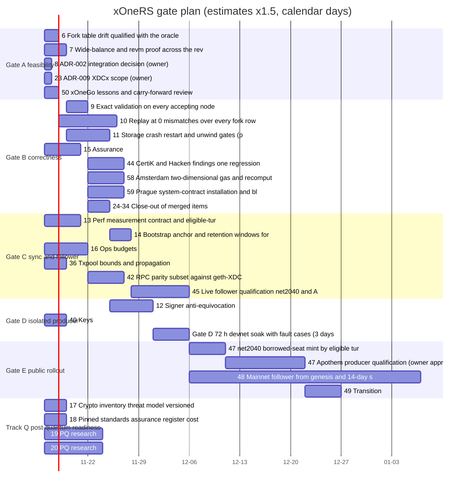

# xOne execution plan

This plan describes the source reviewed at `876bb8e9679d3df67aabccea32cfe7047a3284c3`. [#51](https://github.com/XDCIndia/xOne/issues/51) holds the build backlog and final gates. [#57](https://github.com/XDCIndia/xOne/issues/57) defines readiness for individual deliverables. The filename is retained for existing links; the first skeleton batch is historical.

## Goal

Deliver an XDC-compatible client that can initialize, follow, restart and serve its supported operator interfaces from a qualified artifact. Acceptance requires execution on the client's own state, exact consensus validation, durable canonical and signer state, interoperable sync, measured resource behavior and the declared network soaks. Merged modules and short diagnostic runs are progress toward those gates.

Keep Rust for the core and Go for the pinned oracle/exporter. Keep post-quantum readiness and protocol research separate from current-consensus implementation. Neither a language choice nor a microbenchmark establishes quantum resistance or network finality latency.

## Current evidence

PR #93 merged the development follower, sync, observability, snap, V2 replay and BFT slices. Its author reports local tests and a short private-loopback follow. Hosted CI at the integration head failed; the reported billing cause has not been independently established by this source review.

[RUNS.md](../../conformance/harness/RUNS.md) records a 432,000-block Apothem genesis replay and separate diagnostic pivot windows. The V2 pivot window covers 302 epoch switches; the 1,000-switch and full-history gates remain open. Archive-sourced pivots do not establish authenticated bootstrap. Node/sync contexts still lack the V2 gap-snapshot wiring required at checkpoint blocks, and `FileStore` does not persist staged-sync rows.

The [current review snapshot](../../.audit/current-review.json) is a source-audit record. It is not a worker lease, test result or gate-completion ledger. Preserve historical run records and add exact provenance for new results.

## Readiness and ownership

Start a deliverable when its own prerequisite outputs have the required evidence. A parent issue can stay open while a dependent foundation slice proceeds. For example, storage design can enable a writer implementation while the storage umbrella still awaits real I/O and unwind proof. Keep every final parent acceptance criterion.

Before a worker changes code, record its deliverable, responsible session, branch/worktree, base and head, owned paths, prerequisite evidence, pending writes and next action. Reconcile current remote state before claiming work. One integrator owns shared manifests, lockfiles and branch integration. Preserve another session's branches and datadirs.

Use these states distinctly: proposed, implemented, reported tested, independently tested, merged and qualified. A merged PR does not automatically advance an umbrella to qualified. [#57](https://github.com/XDCIndia/xOne/issues/57) still owns the machine-readable deliverable graph, readiness validation and active-session ledger; this document does not claim those tools exist.

## Next deliverables

Work on independent slices in parallel only after ownership and interface boundaries are clear. Start import coherence and datadir ownership first; run independent CI guard work in parallel. Serialize edits that share node-service or RPC files.

| Order | Deliverable | Evidence needed before integration |
| --- | --- | --- |
| Parallel | [#101 CI guards](https://github.com/XDCIndia/xOne/issues/101) ([PR #102](https://github.com/XDCIndia/xOne/pull/102)), [#6 oracle drift](https://github.com/XDCIndia/xOne/issues/6) and [#57 readiness](https://github.com/XDCIndia/xOne/issues/57) | Scan errors and real-crate violations fail the assurance runner; missing oracle access cannot appear qualified; seeded drift fails; hosted CI state is separate from local checks |
| 1 | [#95 Import coherence](https://github.com/XDCIndia/xOne/issues/95) | Fallible consensus-context work cannot leave durable head and visible history split; post-commit failure and restart regressions pass |
| 2 | [#97 Exclusive datadir ownership](https://github.com/XDCIndia/xOne/issues/97) | A second opener is refused before recovery, truncation, key-file changes or publication; the ownership guard covers the required process lifetime |
| 3 | [#94 Empty transaction rejection](https://github.com/XDCIndia/xOne/issues/94) | Malformed wire input reaches a typed rejection before size calculation; no import-task panic |
| 4 | [#96 Discovery clock](https://github.com/XDCIndia/xOne/issues/96) | The runtime uses the correct absolute-expiry clock and completes a controlled exchange with an independently clocked peer |
| 5 | [#99 Log-query bounds](https://github.com/XDCIndia/xOne/issues/99) and [#100 RPC state views](https://github.com/XDCIndia/xOne/issues/100) | Maximum-u64 ranges cannot bypass work limits; queries retain a consistent state view or return a typed availability error |
| 6 | [#98 Sync confirmation](https://github.com/XDCIndia/xOne/issues/98) | Confirmation is bound to peer/session/head and expires on disconnect; an echo-only high-ranked peer cannot prevent progress |

These regressions feed the existing execution, storage, consensus and operator umbrellas. After them, complete the actual staged-sync wiring and persistence, V2 checkpoint contexts, transport policy in [#60](https://github.com/XDCIndia/xOne/issues/60), supported operator surfaces and remaining interoperability. Keep full replay, real storage-fault testing, isolated producer proof, exact packaged-artifact conformance and public qualification. Refresh the next batch when a decisive result changes readiness.

## Workflow

1. Read the current tracker, review snapshot and active execution state. Claim one ready deliverable on nonoverlapping paths.
2. Keep the declared source, oracle and fixture pins fixed. Establish a failing regression or measured baseline. Re-pin only through an explicit reviewed change and rerun the affected evidence.
3. Implement one bounded change against the agreed interface. Use Sonnet for implementation and substantive review, and Haiku for bounded extraction or fixture bookkeeping, only when those models are actually available. Record the provider used; do not claim an unavailable route ran.
4. Run targeted checks and the relevant differential, negative-input, fault, interoperability or performance gate. Record the exact command, source tree, artifact/input digests, environment, result and remaining parent criteria.
5. Have an independent verifier repeat the decisive check on a clean checkout with the same inputs.
6. Open one PR with the required repository identity/trailers, specification link, evidence and limits. Integrate under the existing review and merge authority.
7. Update the deliverable and parent evidence. Close the parent only when all its acceptance criteria pass.

## Verification loop

Select ready output -> establish failure/baseline -> implement -> targeted checks -> decisive gate -> independent verification -> PR/integration -> checkpoint -> select the next ready output.

A code, specification, fixture or dependency change invalidates the evidence it affects. Run full historical replay at declared integration boundaries and relevant pin changes. Do not rewrite expected output, skip validation or reduce a gate to obtain a pass. Three failures of an unchanged approach require a written root-cause decision and alternatives. A root, durability or signing fault stops the affected qualification path; unrelated work can continue.

Checkpoint after each decisive result and external write. On a rate limit, retain Retry-After/reset metadata, reduce concurrency and use bounded backoff. Reconcile an uncertain mutation by its stable issue/PR identity before retry. Do not claim automatic resumption without an actual scheduler.

## Final qualification

Keep Gate A feasibility, Gate B foundational correctness, Gate C sync/resources and follower qualification, Gate D isolated producer safety, and Gate E packaged release/public rollout. Evidence for a prerequisite deliverable permits dependent engineering work; it does not bypass a final gate.

Before public producer qualification, complete the required B/C/D evidence, exact-artifact checks and the authorized host/run decisions in [#47](https://github.com/XDCIndia/xOne/issues/47). Keep the mainnet follower's full own-state replay and 14-day soak in [#48](https://github.com/XDCIndia/xOne/issues/48). Mainnet signing and protocol activation remain separate decisions. Track Q research cannot substitute for those client gates.

## Estimates and schedule

Added for issue #204. Every estimate below is a rough figure in calendar days, multiplied by 1.5 (the factor of the Lambda engineering philosophy, principle 12; change it in the weekly table below when the actuals say so). Start date of the chart: 2026-11-16, no work item runs before its dependencies. Dates are plan dates, not promises.

Basis, from the merged history of `main` (72 pull requests between 2026-11-10 and 2026-11-14; `gh pr list --state merged`): a bounded work item with a clear spec took 0.5 to 1 day (for example #75 keys, #76 special transactions, #84 txpool, all merged 2026-11-11); an item that needs a live run on a public network took 1 to 3 days per run (net2040 sync-mode runs of 2026-11-12, PR #110, #124, #127, #131); a soak or an owner decision is calendar time and does not shrink with more workers. Open items are the issues of #5 and #51 that are open on 2026-11-14 or whose evidence is not yet qualified (merged is not qualified, see #57).

Closed issues are not listed: #35, #38, #43 (producer code; its 72 h soak is item d72 below) and #46.

| Item | Issue | Gate | Work | Raw days | x1.5 | Start | End | After |
| --- | --- | --- | --- | ---: | ---: | --- | --- | --- |
| a6 | #6 | A | Fork table drift qualified with the oracle key (owner supplies key) | 1 | 2 | 2026-11-16 | 2026-11-18 | - |
| a7 | #7 | A | Wide-balance and revm proof across the revert matrix | 2 | 3 | 2026-11-16 | 2026-11-19 | - |
| a8 | #8 | A | ADR-002 integration decision (owner) | 0.5 | 1 | 2026-11-16 | 2026-11-17 | - |
| a23 | #23 | A | ADR-009 XDCx scope (owner) | 0.5 | 1 | 2026-11-16 | 2026-11-17 | - |
| a50 | #50 | A | xOneGo lessons and carry-forward review | 1 | 2 | 2026-11-16 | 2026-11-18 | - |
| b9 | #9 | B | Exact validation on every accepting node, negative corpus | 2 | 3 | 2026-11-19 | 2026-11-22 | a7 |
| b10 | #10 | B | Replay at 0 mismatches over every fork row and boundary | 5 | 8 | 2026-11-18 | 2026-11-26 | a6 |
| b11 | #11 | B | Storage crash, restart and unwind gates (proof part) | 4 | 6 | 2026-11-19 | 2026-11-25 | a7 |
| b15 | #15 | B | Assurance: lint fixtures, unsafe audit, non-shipping mutants | 3 | 5 | 2026-11-16 | 2026-11-21 | - |
| b44 | #44 | B | CertiK and Hacken findings, one regression each (verification items) | 3 | 5 | 2026-11-22 | 2026-11-27 | b9 |
| b58 | #58 | B | Amsterdam two-dimensional gas and recomputed BAL hash | 3 | 5 | 2026-11-22 | 2026-11-27 | b9 |
| b59 | #59 | B | Prague system-contract installation and block lifecycle | 3 | 5 | 2026-11-22 | 2026-11-27 | b9 |
| b0 | #24-#34 | B | Close-out of merged items: evidence per issue, tick the tracker | 2 | 3 | 2026-11-22 | 2026-11-25 | b9 |
| c13 | #13 | C | Perf measurement contract and eligible-turn accounting | 3 | 5 | 2026-11-16 | 2026-11-21 | - |
| c14 | #14 | C | Bootstrap anchor and retention windows for every rule | 2 | 3 | 2026-11-25 | 2026-11-28 | b11 |
| c16 | #16 | C | Ops budgets: bounded queues, RPC and peer budgets, log and disk limits | 4 | 6 | 2026-11-16 | 2026-11-22 | - |
| c36 | #36 | C | Txpool bounds and propagation | 2 | 3 | 2026-11-16 | 2026-11-19 | - |
| c42 | #42 | C | RPC parity subset against geth-XDC | 3 | 5 | 2026-11-22 | 2026-11-27 | b9 |
| c45 | #45 | C | Live follower qualification, net2040 and Apothem, restarts | 5 | 8 | 2026-11-28 | 2026-12-06 | b10, c14 |
| d12 | #12 | D | Signer anti-equivocation: rollback, restore, failover, adversarial devnet | 4 | 6 | 2026-11-25 | 2026-12-01 | b11 |
| d40 | #40 | D | Keys: node calls keystore, remote signer, custody | 2 | 3 | 2026-11-16 | 2026-11-19 | - |
| d72 | Gate D | D | 72 h devnet soak with fault cases (3 days at least) | 3 | 5 | 2026-12-01 | 2026-12-06 | d12, d40 |
| e47 | #47 | E | net2040 borrowed-seat mint by eligible turns (owner approval) | 3 | 5 | 2026-12-06 | 2026-12-11 | c45, d72 |
| e47b | #47 | E | Apothem producer qualification (owner approval) | 7 | 11 | 2026-12-11 | 2026-12-22 | e47 |
| e48 | #48 | E | Mainnet follower from genesis and 14-day soak at tip | 21 | 32 | 2026-12-06 | 2027-01-07 | c45 |
| e49 | #49 | E | Transition: xOneGo wedge-fix-only, seat move, retirement | 3 | 5 | 2026-12-22 | 2026-12-27 | e47b |
| q17 | #17 | Q | Crypto inventory, threat model, versioned interfaces | 2 | 3 | 2026-11-16 | 2026-11-19 | - |
| q18 | #18 | Q | Pinned standards, assurance register, cost lab (close-out) | 2 | 3 | 2026-11-16 | 2026-11-19 | - |
| q19 | #19 | Q | PQ research: account and validator signatures | 5 | 8 | 2026-11-16 | 2026-11-24 | - |
| q20 | #20 | Q | PQ research: transport, history, release signing | 5 | 8 | 2026-11-16 | 2026-11-24 | - |

Gate close dates (latest end of its items): A 2026-11-19, B 2026-11-27, C 2026-12-06, D 2026-12-06, E 2027-01-07, Q 2026-11-24. Gate E depends on the owner approving each public mint test, and on the 14-day soak, so its date moves with those decisions.

Edges of the chart are the dependencies in the table: A items feed the B proofs (#7 feeds #9 and #11, #6 feeds #10), B feeds the live follower (#45) and the signer gates, and C and D feed Gate E. Update the chart and the table when a gate item closes.

### Weekly estimate against actual

Add one line per week. Factor = actual days divided by raw estimate days for the items closed that week; change the 1.5 above when three weeks in a row differ.

| Week | Estimated (raw days, items) | Actual | Factor | Note |
| --- | --- | --- | ---: | --- |
| 2026-11-09 | none (no estimate existed) | 72 PRs merged 2026-11-10..14: gate A set, most of B and C code, producer, release, net2040 and Apothem follow | n/a | baseline week; merged is not qualified, so no item is counted closed |
| 2026-11-16 | first estimates above | | | |
