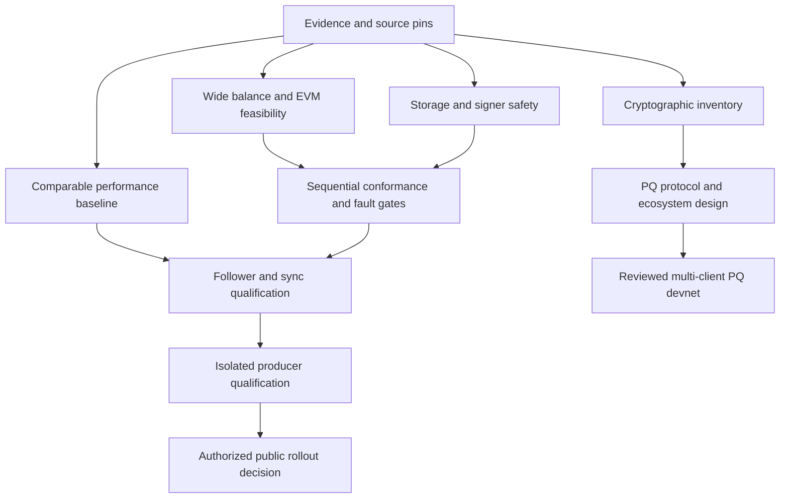

Research date: **10 November 2026**. Added to the repository on 11 November 2026.

# xOne architecture scale and post quantum review

Prepared for Anil Chinchawale, Head of Protocol Engineering, XDC Network.

This advisory review evaluates the [rebuild plan in issue #1](https://github.com/XDCIndia/xOne/issues/1). It proposes changes for review; it does not replace accepted ADRs or authorize production operations. The [skills PR #2](https://github.com/XDCIndia/xOne/pull/2) is separate work. Commands, vectors and Rust modules discussed below are proposed deliverables unless verified at the implementation pin.

> **Recommendation:** Keep Rust as the preferred core language, with Go for the reference oracle. Make that choice conditional on wide-balance, revm and networking spikes. Move durability and signer-safety gates before any public producer test. Run post-quantum migration as a separate, coordinated protocol workstream.

### What the plan gets right

Pinned rules, mandatory root validation, explicit journals, canonical reward collection, a conformance corpus, durable voting records, and a follower-first rollout are sound foundations. Preserve them. Rust alone cannot establish consensus correctness, predictable latency or quantum resistance.

### What this review covers

The complete 753-line attachment, selected XDC source at its stated pin, the campaign tracker and comments, and primary architecture material across execution clients, scalable validators, storage systems and cryptographic standards. This is a representative design review, not an exhaustive audit of every open-source project. No benchmark or validator experiment was run for this review.

### Evidence boundary

The tracker confirms that the incidents and observations were reported. It does not independently reproduce their causes or establish performance rankings. Root-cause corrections in later comments supersede earlier hypotheses. Selected geth source checks are stronger evidence than prose claims; the implementation backlog must extend those checks to exact SHAs, files and reproducible artifacts. [1-3]

Companion: [Claude audit and issue-creation prompt](../prompts/architecture-audit-and-issue-creation.md). Adding these documents does not run that prompt or create the proposed finding issues. Refer to the [machine-readable source register](2026-11-10-architecture-scale-pq-sources.json) for the 40 primary references.

## Correctness blockers

| Plan location | Problem | Required correction |
| --- | --- | --- |
| B3.1 / S1 | **WideBalance is underspecified.** The pinned account stores BigBalance as arbitrary-precision big.Int. A low U256 plus one carry limb and an always-33-byte encoding need a proved bound. [2] | Specify legal range and exact RLP. Cover carry/borrow, BALANCE, SELFBALANCE, transfer checks, fees, rewards, CREATE, SELFDESTRUCT, special transactions, precompiles, nested reverts and snap round-trips. Prove adapter equivalence before selecting it. |
| A4.3 | **Followers cannot approximate consensus fields.** The plan suggests followers can pass with approximate Validators or Penalties. | Every accepting node must validate the exact applicable rules. Producers additionally construct valid blocks. Turn this into positive and negative consensus tests. |
| B3.2 / G1 | **Fresh oracle prestate can hide state bugs.** Independent per-block fixtures do not prove accumulated local state, restart or unwind correctness. | Authoritative replay starts at genesis or an authenticated pivot and uses xOne's own state thereafter. Compare independently computed roots and consensus auxiliaries; use oracle prestates only for isolated diagnostics. |
| Loop / Workflow 3 | **One oracle is insufficient.** Generated rules and expected outputs from one implementation can share its mistakes. Canonical history does not test rejection. | Keep geth parity; add independent specification review, applicable EELS valid/invalid cases, XDC synthetic/property tests, cross-client checks and deterministic fault schedules. [8-9] |
| G1 | **Input identity is not independent validation.** Comparing imported header hash or extraData to the input can be tautological. | Recompute commitments and verify signatures, roots and field rules. For produced blocks, compare under fixed inputs or rule validity; valid timestamps and transaction choices can yield different block hashes. |

These are blockers in the proposed design contract, not a claim that the unbuilt Rust client already contains these defects. S1 must test a boundary matrix, not only one wide credit and one sign transaction.

## Durability and signing safety

### A database transaction is not a transaction across every file

ADR-005 puts hot state in MDBX and headers, bodies and receipts in external static files. One MDBX transaction cannot, by itself, atomically publish those files. Specify ordered staging, checksums, flushes, a durable generation marker, head publication and restart reconciliation. Keep incomplete files invisible; define truncation, quarantine, interrupted pruning and ENOSPC/EIO behavior. [10, 22]

### Separate chain rollback from signing history

Reorgable state and monotonic anti-equivocation state have different lifecycles. SetHead, changeset unwind, backup restore and snapshot import must never lower signing safety. Persist the precise signing intent and required safety state before releasing a signature; specify idempotent retry and recovery after an ambiguous send. A local process check does not fence a duplicate signer on another host. [11]

### Resolve the pure-consensus contradiction

R3 says consensus does no I/O, but Flow has consensus write the database and send messages. Use a deterministic state machine that emits typed effects. The outer driver completes durable persistence, receives the acknowledgment, then permits the network effect. Make cancellation, failure and restart transitions explicit.

| Fault class | Acceptance evidence |
| --- | --- |
| Process crash | Kill at each journal, commit, safety-record and publication boundary. Recover the same canonical state and signing constraints. |
| Host or device failure | Inject lost/reordered/short writes and sync failures under the declared filesystem/device model. kill -9 alone does not simulate power loss. |
| Rollback / failover | Restore stale backups, move a signer, reorg across special transactions, and retry pending votes. No conflicting signatures; no safety-state rollback. |
| Deterministic simulation | Control clock, network, randomness and disk effects. Save seed, minimized trace and expected invariant failure. Borrow TigerBeetle's method without adopting its consensus. [12] |

**Gate change:** move foundational M7 work into storage and V2 development. Crash, unwind and signer-recovery gates must pass before M6 tests a public validator. Random-kill counts supplement targeted boundary coverage; they do not prove all failure paths.

## Sync, benchmarks and operational gaps

| Gap | Change to make |
| --- | --- |
| Snapshot trust | A hash-pinned manifest proves byte identity, not a legitimate or fresh chain anchor. Bind chain ID, genesis, checkpoint hash, state root, certificate/validator provenance, format version and freshness policy. Test malicious manifests, bad proofs and interrupted import. [4] |
| Retention | Derive lookbacks for every reward, penalty, gap, finality, reorg and RPC rule. Two epochs and 50 random pivots are sampling choices, not a proof. Add pivots at every discontinuity and explicit unsupported-history responses. |
| Footprint comparison | A2 mixes importing and steady producers, full-state and pruned modes, cgroup including cache and runtime/RSS observations, and shared hosts. Re-measure identical semantics, height, retention, workload, hardware and durability. |
| 10 GB / 1.5 GB targets | Label G4/G8 as workload-specific targets. Live state can grow without bound. Separate process memory, mmap/page cache and cgroup memory; include staging, compaction and recovery disk headroom. |
| Short mint gate | The tracker's 1,800-block window records only 17-20 turns per client. Require actual eligible turns, elapsed time, restarts, epoch changes and fault cases, plus all misses and causes. Zero observed misses is not a reliability guarantee. [1] |
| Lints and build rules | Several R3 entries are policy descriptions, not ready-made Clippy lint names. Configure disallowed methods/types or custom checks, prove enforcement with failing fixtures, and isolate mutation tests from shipping builds. Audit native/unsafe transitive code. [13] |
| Resource starvation | Bound per-peer and global budgets; prioritize round timers, verification and durable signing over RPC traces, snapshot serving and pruning. Specify queue overflow, cancellation, timeouts, stale work and recovery. |
| Schedule and diversity | Replace contradictory sequential milestones and parallel M5 claims with a gate DAG. Re-estimate after spikes. Map shared revm/trie/crypto dependencies and stake exposure; a seventh binary does not necessarily add an independent failure domain. |

## Execution clients worth studying

| Project | Borrow | Boundary and cost |
| --- | --- | --- |
| Geth / XDC geth Go [1-4] | XDC reference rules and oracle; authenticated state-sync checks; established operations. | Preserve versioned XDC semantics. Importing geth packages reduces some implementation risk but does not remove adapter, fork or shared-bug risk. |
| Reth + revm + alloy Rust [5-6] | Modular components, EVM handler/journal/database seams, staged persistence and reusable primitives. | Prove wide-account/trie/unwind compatibility at the actual pin. Current Reth Storage V2 uses RocksDB indices and static changesets; do not generalize the attachment's older layout. |
| Erigon Go [7] | Hot/cold separation and immutable historical segments; offline import and stage checkpoints. | Complete segment sets, indexes, durable publication and pruning rules need explicit checks. XDC-specific wire/fork behavior remains separate. |
| Besu Java [14] | Bonsai location-addressed storage, direct leaf access and trie logs; useful recent-state/history trade-offs. | Bonsai recent-state access is not archive equivalence. Storage design and workload, not Java alone, explain footprint. |
| Nethermind C# [15] | Modular architecture and hybrid pruning; study resource controls for online pruning. | Pruning competes with import/producer work. Runtime tuning and the exact XDC integration require measurement. |
| ethrex Rust [16] | Inspect a smaller modular client and its EVM/state boundaries; use as a design and independent-test candidate. | No implied XDC compatibility or performance ranking. Review exact APIs, maturity, dependencies and test coverage. |
| Silkworm / evmone C++ [17] | Reusable native EVM and execution/storage separation; inspect low-level profiling and independent execution checks. | Memory safety, native build, FFI and maintenance costs. A component benchmark does not establish end-to-end client speed. |

### Reuse decision

Prefer the smallest dependency surface that preserves XDC rules and can be independently tested. Compare SDK integration, selected crates and a small maintained adapter/fork in M0. A blanket no-fork rule can encourage fragile wrappers; require evidence on correctness, upgrade cost and upstreamability before choosing.

## Scalable systems worth studying

| Project | Useful pattern | XDC limit |
| --- | --- | --- |
| Firedancer / Agave C / Rust [18-19] | Pipeline stages, signature verification, bounded queues, CPU affinity and isolated signing. | Solana scheduling differs from arbitrary EVM accesses. Dedicated busy-polling cores raise the hardware/power floor. Local synthetic throughput is not WAN finality. |
| Monad / MonadDb C++ execution [20-21] | Read prefetch, immutable versions, asynchronous I/O, speculative execution with ordered merge. | Prove serial equivalence. Current documented page commitments include BLAKE3: copying that format would change XDC state commitments. Borrow physical I/O ideas, not consensus encodings. |
| Aptos / Block-STM Rust [23] | Speculative parallel execution with dependency detection and results equal to a preset serial order. | Conflict-heavy EVM paths, XDC native hooks, fees and wide balances must preserve that property. Published Aptos workloads are not XDC TPS estimates. |
| Sui Rust [24] | Explicit transaction lifecycle, parallel work on nonconflicting inputs, clear settlement evidence. | Move/object semantics and its consensus differ from XDPoS. Do not transplant its latency numbers or rely on stale descriptions of transaction paths. |
| Seastar / ScyllaDB C++ [25] | Per-core ownership, message passing and asynchronous storage/network work. | Sharding workers does not remove shared-account conflicts or canonical order. Adopt ownership patterns before considering a framework rewrite. |
| TigerBeetle Zig [12] | Bounded resources, batching and deterministic simulation of real cluster code under faults. | Its transfer state machine is much narrower than an EVM, and its replication model is not XDPoS. |
| MDBX / RocksDB native [22, 26] | Transactional batches, consistent read views, explicit sync/WAL contracts and storage metrics. | MDBX reader lifetime/page faults and RocksDB compaction/write amplification need comparable experiments. Never compare different durability modes as equivalent. |

**Implementation order:** start with parallel stateless checks and read-only prefetch, isolate consensus/signing, and profile. Prototype parallel EVM execution later, behind serial-equivalence tests and bounded speculative memory. Workers never publish canonical state directly.

## Language recommendation and trade-offs

| Language | Pros | Cons / decision |
| --- | --- | --- |
| Rust | Ownership, safe-code data-race guarantees, allocation/layout control, no tracing GC, strong EVM/client ecosystem. | Build time, learning curve and async complexity. Native dependencies remain in the trust boundary. Preferred for the core if M0 compatibility and durability spikes pass. |
| Go | Existing XDC/geth code and team experience, direct reference reuse, straightforward concurrency and fast builds. | GC/heap tuning, shared-state discipline and dynamic race coverage. Best oracle/tooling choice and credible core fallback. Reuse still needs integration tests. |
| C / C++ | Mature native networking, SIMD and storage; strong examples in Firedancer, Monad, Silkworm and Seastar. | Memory/undefined-behavior assurance and portability cost. Use a proven component only when measured benefit justifies its boundary. |
| Java | Besu ecosystem, runtime optimization, mature profiling and productive engineering. | JIT/warmup/heap/GC tuning. The campaign's observed RSS is not a universal JVM minimum. |
| C# / .NET | Nethermind ecosystem, good instrumentation, productive runtime and possible AOT paths. | GC/runtime/dependency tuning; AOT feasibility is component-specific. No inherent millisecond or memory guarantee. |
| Zig | Explicit allocation and low-level control; suited to bounded systems with strong simulation discipline. | Smaller EVM/XDC ecosystem and a higher custom assurance burden. Do not equate Zig with Rust ownership safety or infer suitability from TigerBeetle alone. |
| Nim / Python / TypeScript | Nim is worth tracking in client research; Python/TypeScript are useful for tests, exporters and operator interfaces. | No demonstrated reason here to replace Rust/Go for this rebuild's execution core. Tooling suitability does not establish consensus-core suitability. |

### Correct the original language claims

Go named types provide real static distinctions. Rust removes many memory/data-race faults in safe code, but logical races remain possible. No-GC does not remove allocation, I/O, scheduler or lock stalls. Neither language guarantees a fully static portable binary when native storage/crypto dependencies are involved. Go's GC guide describes tunable CPU/heap trade-offs, not a fixed RSS multiplier. [27]

> Choose **Rust core + Go oracle** for maintainable correctness and headroom. Do not rewrite the whole node for a language speed claim. If revm cannot express XDC behavior cleanly, compare a scoped upstream hook/fork with Go reference reuse before expanding the adapter.

## What milliseconds and nanoseconds can mean

| Boundary | Useful measurement | Honest target policy |
| --- | --- | --- |
| Tiny in-cache operation | ns/op or cycles/op; input size, compiler and CPU fixed. | Suitable for a lookup, queue operation or selected primitive. Prevent dead-code elimination; include variance and measurement overhead. |
| Crypto / decode / trie work | us or ms, separated by message/input size and valid/invalid path. | Measure pinned implementation and CPU paths. No universal PQ-signature or trie-access SLA. |
| RPC read / admission | Arrival-to-response p50/p95/p99/p99.9, errors and load. | A warm local read may have a provisional p99 <10 ms target; this is a proposed goal, not an observed xOne result. Bound method complexity and concurrency. |
| Block import / build | Queue + validation + execution + root computation + durable commit. | Set p99 from the configured slot budget and required network/signing margins. Report each stage and the whole path under peak and adversarial load. |
| Inclusion / finality | Client submission to explicitly defined chain settlement evidence. | Measure a multi-node WAN-like deployment under quorum/network assumptions. Existing consensus rules and propagation constrain it; a faster interpreter cannot promise ns finality. |

### Do not confuse rate and latency

At 3,000 transactions per second, 1 / 3,000 is a mean arrival interval of about 333 microseconds. That is not transaction execution time or settlement latency. At a 2-second block interval, 3,000 TPS is approximately 6,000 transactions per block, subject to gas and payload limits. These are calculations, not benchmark results.

### A reproducible performance contract

Pin hardware tier, CPU/ISA, core count, storage, filesystem, kernel, release profile, SHA, chain/height/hash, durability flags, topology, retention, workload and input hashes. Test warm/cold state, transfers, contract-heavy replay, hot accounts, forks, rewards, reorgs, malformed traffic, pruning and restart. Record raw histograms, observed max, samples/errors, CPU, RSS/cgroup/cache, I/O, queue depth, network bytes and conflict retries.

Use open-loop load or a coordinated-omission-aware method below, near and above saturation. Include a sustained soak and repeat runs; disclose load-generator limits. Begin with correctness-preserving optimizations and keep the same durability contract in every comparison. Firedancer's tuning guide explicitly scopes its local synthetic benchmark. [18, 28]

## Post-quantum architecture

> Replace the promise **quantum proof** with **post-quantum migration readiness under explicit security assumptions**. No language or single cryptographic library can guarantee resistance to all future attacks.

The supplied plan has no PQ workstream. Its B10 wire/consensus freeze is appropriate for the compatible rebuild, but a later PQ transition may require versioned changes to transaction authentication, votes, key registration and transport. A single client cannot activate incompatible rules safely. Separate compatible engineering from reviewed protocol proposals and coordinated activation.

| Standard | Use | Boundary |
| --- | --- | --- |
| FIPS 203 / ML-KEM [29] | Candidate key establishment for a reviewed, negotiated hybrid transport. | Not a signature scheme and not peer identity authentication by itself. |
| FIPS 204 / ML-DSA [30] | Candidate account, validator or infrastructure signatures after protocol/audit review. | Larger messages; no automatic BLS-style aggregation or legacy ecrecover compatibility. |
| FIPS 205 / SLH-DSA [31] | Stateless hash-based signature candidate for algorithm-diverse recovery/root/signing studies. | Substantial signature bandwidth and workload-specific cost; not automatically a high-rate validator choice. |

### Quantify the bandwidth before picking a scheme

FIPS 204 Table 2 gives ML-DSA-65 a 1,952-byte public key and a 3,309-byte signature. With one signature per transaction at 3,000 TPS, signatures alone require 9,927,000 bytes/s, about 9.93 MB/s or 79.42 Mbit/s. This excludes public keys, hybrid classical signatures, payloads, votes, fanout and retransmission. It is arithmetic, not a measured network result. [30]

### Implementation assurance

Pin standards, parameter sets and applicable errata. Require implementation audit scope, platform support, constant-time/side-channel review, entropy and zeroization checks, conformance vectors and dependency provenance. The inspected ml-dsa 0.1.2 documentation says it has not had an independent audit; liboqs describes a prototyping role and discourages production reliance. Do not treat pure Rust or a FIPS algorithm name as module validation. [32-33]

Ethereum's PQ program separates execution, consensus and data migration. Use that layered method; its research roadmap and schemes are not XDC deployment instructions. [34]

## Post-quantum migration checklist

| Surface | Required design and gate |
| --- | --- |
| Accounts / wallets | Inventory ECDSA/ecrecover, exposed public keys, transaction envelopes, recovery and upgrade authorities. Specify registration, migration and replay rules. A PQ verifier does not protect an account if a vulnerable legacy owner or fallback can still move funds. |
| Validators / QC / timeout | Version key registries and message domains; define exact signature/QC formats, size limits, mixed-version behavior and activation boundaries. Include malformed/invalid signature floods, key rotation and remote-signer recovery. Do not invent aggregation. |
| P2P identity / transport | Review RLPx secp256k1 ECIES/ECDH, identity and discovery. Design transcript binding, authenticated key exchange and downgrade resistance. ML-KEM added to a channel does not replace vulnerable identity authentication. [35] |
| History / checkpoints | Define what fresh bootstrap trusts and how checkpoints, validator-set transitions, light clients and bridges retain authentic history. A future signature change does not retroactively secure every historical proof. Study Algorand state-proof trust boundaries. [36] |
| Bridges / governance / releases | Map every signer and upgrade/recovery key, not only ordinary accounts. Include HSM support, backup, software-release signing and custody dependencies. A chain-level upgrade cannot secure a third-party bridge by itself. |
| Hashes / proof systems | Inventory actual Keccak/address/hash/proof uses and activated precompiles. Do not replace trie commitments, address formats or pairing-based systems without a separate protocol specification. Do not import unused Ethereum-roadmap features. |
| Hybrid and fallback rules | Specify the reviewed combiner and message/key binding. Where protection requires both signatures, require both. An OR fallback can leave the classical forgery route open. Migration authorization must happen while the old authority remains trustworthy. |
| Stateful signatures | If XMSS/LMS or another stateful design is studied, prove durable one-time-state reservation across restore, failover and retries. State reuse can be catastrophic; ordinary datadir rollback must never restore signer indices. [37] |

**Two tracks:** compatible client work can add an inventory, versioned internal interfaces and benchmark harnesses now. Protocol work needs a specification, audit, multi-client devnet, wallets/signers, governance and staged activation. Explicitly permit isolated PQ research in K9 while keeping unactivated rules out of production.

## Revised architecture and gate order

| Layer | Responsibility and invariant |
| --- | --- |
| Rules and primitives | Pinned network rules, typed heights/rounds, exact account/transaction/header encodings and cryptographic domains. Missing required values fail closed. |
| Consensus core | Pure transition function plus typed effects. Exact verification for all accepting nodes. Clock/network/storage effects supplied by the driver and simulator. |
| Execution / state | Pinned EVM plus proven XDC adaptation; local accumulated state; read-only worker views; one canonical commit owner. No process-global consensus side records. |
| Durability / signer | Versioned block commit and recovery protocol across DB/segments; monotonic anti-equivocation record; authenticated single-signer boundary and tested handoff. |
| Node services | Bounded P2P, sync, RPC, builder and snapshot queues with priority/admission rules. Production execution has no live oracle dependency. |
| Verification / research | Go oracle, immutable historical fixtures, spec-derived negative/property cases, mutation detection, simulation, performance and PQ labs. Fault injection cannot ship as a validation bypass. |

| Gate | Evidence before advancing |
| --- | --- |
| A / feasibility | Pin sources and baseline. Prove full wide-balance/special-tx matrix, network compatibility, SDK alternatives and cross-store recovery design. Revisit language/integration only on evidence. |
| B / foundational correctness | Genesis and rule extraction; sequential V1/V2/fork replay; malformed-input rejection; journals, reorg and restart properties. Signing safety and simulation are already active. |
| C / sync and resource behavior | Authenticated bootstrap, retention proof, serving interoperability, overload isolation and recovery; comparable latency/memory/storage baseline. |
| D / isolated producer | Local multi-node adversarial devnet; durable vote/timeout ordering, signer fencing, fault recovery and deterministic construction tests. |
| E / public rollout | Only after B-D pass: authorized testnet producer soak counted by eligible turns; independent verification, rollback rehearsal, then mainnet follower soak. Mainnet signing remains a separate decision. |
| Q / PQ protocol | Parallel inventory/research; multi-client activation depends on approved protocol, ecosystem readiness, audits and devnet gates, not on A-E completion alone. |

## Dedicated issue candidates

These are proposed work items, not newly verified implementation defects. Split or merge after inspecting the target repository and existing issues. P0 denotes a safety prerequisite for this plan. Priority is separate from whether a production exploit exists.

| Priority / track | Dedicated outcome | Acceptance evidence |
| --- | --- | --- |
| P0 / core | Wide-balance and revm feasibility | Pinned rule matrix; every carry/borrow/revert/special path agrees; justified range and encoding. |
| P0 / core | Exact follower validation | Bad validator/penalty/QC/body/root inputs reject; applicable valid inputs accept. |
| P0 / core | Sequential and independent conformance | Candidate-owned state, independent invariants and spec-provenanced positive/negative corpus. |
| P0 / storage | Cross-store commit / recovery | Crash tests around every publication boundary; consistent head, state, segments and receipts. |
| P0 / signer | Monotonic signing and failover | No conflicting signatures through reorg, kill, stale restore, retry and host handoff. |
| P0 / process | Revised gate DAG and safety order | Restart/signing gates precede producer; each dependency and release decision explicit. |
| P1 / sync | Authenticated bootstrap and retention | Anchor/finality/freshness verified; every lookback covered; malicious-pivot tests reject. |
| P1 / perf | Baseline, SLOs and pipeline isolation | Comparable raw histograms and resource data; overload cannot starve consensus. |
| P1 / assurance | Lint enforcement and nonshipping mutants | Failing fixtures prove checks; release artifact excludes bypass/fault code. |
| P1 / design | SDK / crate / fork / Go decision | Spike evidence, maintenance cost, licensing and dependency-diversity matrix. |
| P1 / PQ ready | Threat model, crypto inventory and APIs | All authorities/domains mapped; no activation or security claim implied. |
| P1 / PQ ready | Standards, audits and cost lab | Pinned algorithms/errata; valid/invalid costs, platform coverage and bandwidth model. |
| P2 / PQ protocol | Account and validator migration | Separate issues for wallet authority, key registry, signatures, QC and governance; devnet vectors. |
| P2 / PQ protocol | Transport, history and ecosystem | Separate issues for identity/KEM, checkpoints, bridges, HSM and release infrastructure. |
| P2 / scale research | Serial-equivalent parallel execution | Conflict matrix, exact receipts/state/gas/log order, bounded retry/memory and repeatable gain. |

## Workflow after issue creation

### Define the goal

Deliver an XDC-compatible, independently verifiable client with correct execution, durable signing and predictable behavior under a documented workload. Add PQ migration readiness without silently changing network rules. Optimize measured bottlenecks after the safety baseline passes.

### Create the backlog first

Read the repository and existing work at exact pins. Classify each candidate as observed, reproduced, inferred risk, proposal or blocked. Discover relevant projects by subsystem; record what was reviewed and excluded. Deduplicate by root cause and acceptance contract. Publish one issue per actionable finding and a tracking issue with dependencies. Do not manufacture findings to hit a count.

### Use the requested 13 sections

What; Why; 80% of the way to; ~ASD-STE100; Diagrams; Images; Prompt; Workflow; Loop; Graph; Layout; Flow; Summary. The acceptance section and plain-technical-English section remain separate, as in the attachment. State that the writing approximates STE principles and is not certified compliance. Images contain real supporting evidence or a justified N/A, not invented screenshots.

### Execute only after the planning phase

The [companion Claude prompt](../prompts/architecture-audit-and-issue-creation.md) defaults to research, issue creation and a dependency-ordered execution plan. It does not treat backlog completion as deployment or implementation approval. For a later authorized implementation run: lease one issue, add a failing test or measurable baseline, implement the smallest coherent change, run the impacted gates, independently verify, open a PR, and update evidence. Merge/release/signing follow the authorized policy.

### Repeat on evidence, with stop conditions

Restart the impacted loop on a code/spec/corpus/dependency change. Reject any attempt to weaken consensus checks or rewrite expected outputs to pass. A safety fault stops the affected rollout; unrelated safe research can continue. Three unchanged verification failures require a written root-cause/escalation decision. Finish a review pass after two bounded discovery sweeps add no actionable findings in the reviewed scope; never claim no gaps exist everywhere.

### Keep sessions and agents recoverable

Use one coordinator, bounded subsystem workers and an independent verifier. Give each worker a file/subsystem owner and input pin. Persist claims, hashes, issue URLs, leases, next actions and pending mutations. On a rate limit, honor Retry-After, reduce concurrency and checkpoint; never evade provider limits. Reconcile an ambiguous create/PR response before retrying. Resume from the ledger instead of replaying the full conversation.

> **Immediate next work:** wide-balance/revm feasibility; storage publication and signer-safety contracts; reproducible baseline; PQ inventory. Those four outputs make the later rewrite and performance decisions concrete.

## Proposed gate dependencies

The graph separates compatible client qualification from post-quantum protocol research. Every edge is an acceptance dependency; parallel investigations do not remove integration gates.

## Primary source register

Access date: **10 November 2026**. URLs can change. Pin full source revisions, standards and applicable errata again when implementing an issue. Tracker reports are not independently reproduced benchmark results.

1. [XDC campaign tracker and corrected health/root-cause comments](https://github.com/XDCIndia/go-ethereum/issues/1950)
2. [Pinned XDC account representation, BigBalance](https://github.com/XDCIndia/go-ethereum/blob/5d6ba3664/core/types/state_account.go)
3. [Pinned XDC state access and subtraction](https://github.com/XDCIndia/go-ethereum/blob/5d6ba3664/core/state/statedb.go)
4. [Geth sync modes and state-range proof flow](https://geth.ethereum.org/docs/fundamentals/sync-modes)
5. [Reth Storage V2, current page observed v2.10.1](https://reth.rs/run/storage/)
6. [revm architecture and customization boundaries](https://bluealloy.github.io/revm/architecture.html)
7. [Erigon database and historical segments](https://docs.erigon.tech/fundamentals/database)
8. [Ethereum execution fixture format: valid and invalid blocks](https://steel.ethereum.foundation/docs/execution-specs/running_tests/test_formats/blockchain_test/)
9. [Hive client integration, P2P and API simulations](https://github.com/ethereum/hive/blob/master/docs/overview.md)
10. [MDBX Go bindings and native transaction interface](https://github.com/erigontech/mdbx-go)
11. [CometBFT signing discipline; reference pattern only](https://github.com/cometbft/cometbft/blob/main/spec/consensus/signing.md)
12. [TigerBeetle safety and deterministic simulation](https://docs.tigerbeetle.com/concepts/safety/)
13. [Clippy restriction and disallowed-method/type lint catalog](https://clippy.rust-lang.org/master/index.html)
14. [Besu Bonsai and Forest storage formats](https://docs.besu-eth.org/public-networks/concepts/data-storage-formats)
15. [Nethermind state pruning](https://docs.nethermind.io/next/fundamentals/state-pruning/)
16. [ethrex repository](https://github.com/lambdaclass/ethrex)
17. [Silkworm repository](https://github.com/erigontech/silkworm)
18. [Firedancer stage topology and scoped local benchmark](https://docs.firedancer.io/guide/tuning.html)
19. [Agave repository](https://github.com/anza-xyz/agave)
20. [Monad parallel execution](https://docs.monad.xyz/monad-arch/execution/parallel-execution)
21. [MonadDb versions, I/O and page commitment design](https://docs.monad.xyz/monad-arch/execution/monaddb)
22. [libmdbx native API and durability flags](https://github.com/Mithril-mine/libmdbx/blob/master/mdbx.h)
23. [Block-STM original paper, 2022](https://arxiv.org/abs/2203.06871)
24. [Sui consensus and settlement lifecycle](https://docs.sui.io/develop/sui-architecture/consensus)
25. [Seastar per-core ownership and message passing](https://seastar.io/)
26. [RocksDB atomic batches and write durability](https://github.com/facebook/rocksdb/wiki/Basic-Operations)
27. [Go garbage collector tuning guide](https://go.dev/doc/gc-guide)
28. [wrk2 measurement and coordinated omission](https://github.com/giltene/wrk2/blob/master/README.md)
29. [NIST FIPS 203 ML-KEM and update notice](https://csrc.nist.gov/pubs/fips/203/final)
30. [NIST FIPS 204; Table 2 encoded sizes, PDF page 26](https://nvlpubs.nist.gov/nistpubs/fips/nist.fips.204.pdf)
31. [NIST FIPS 205 SLH-DSA](https://csrc.nist.gov/pubs/fips/205/final)
32. [RustCrypto ml-dsa 0.1.2 audit warning](https://docs.rs/ml-dsa/0.1.2/ml_dsa/)
33. [liboqs limitations and prototyping scope](https://github.com/open-quantum-safe/liboqs)
34. [Ethereum Foundation post-quantum research roadmap](https://pq.ethereum.org/)
35. [RLPx ECIES/ECDH transport specification](https://github.com/ethereum/devp2p/blob/master/rlpx.md)
36. [Algorand state proofs and bootstrap assumptions](https://dev.algorand.co/concepts/protocol/state-proofs/)
37. [NIST SP 800-208 stateful hash-signature guidance](https://nvlpubs.nist.gov/nistpubs/SpecialPublications/NIST.SP.800-208.pdf)
38. [EIP-8189 snap/2, versioned draft status must be checked](https://eips.ethereum.org/EIPS/eip-8189)
39. [Ethereum execution tests migrated into execution-specs](https://github.com/ethereum/execution-spec-tests/blob/main/README.md)
40. [NIST FIPS 204 landing page and 2026 errata notice](https://csrc.nist.gov/pubs/fips/204/final)

### Version-sensitive research notes

- Check protocol capabilities against exact client revisions. EIP-8189 describes snap/2 but does not establish whether a particular Reth build supports snap/1.
- The old `ethereum/execution-spec-tests` repository points fixture consumers to `ethereum/execution-specs`. Resolve current fixture sources before use.
- This repository has no Rust implementation at the reviewed base commit. Proposed module paths, SLOs and gates are planning inputs, not existing guarantees.

